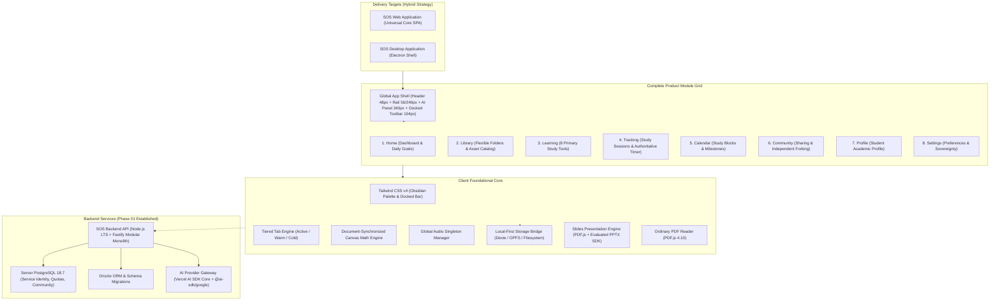
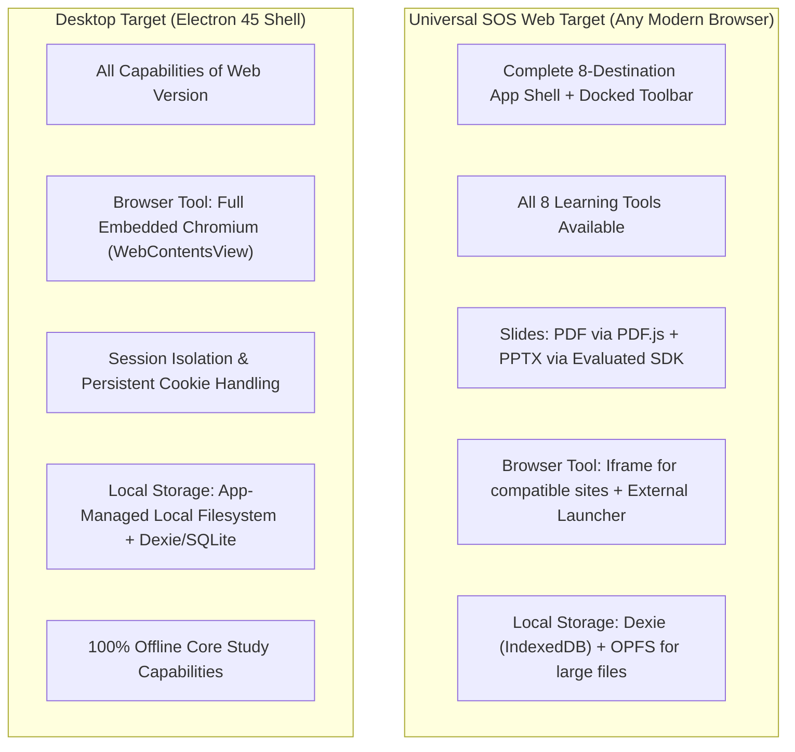
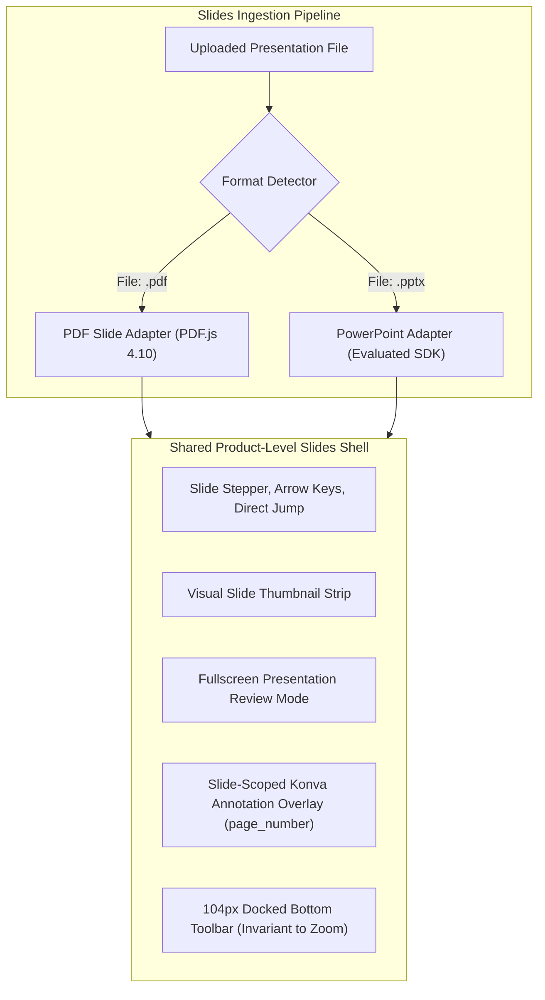
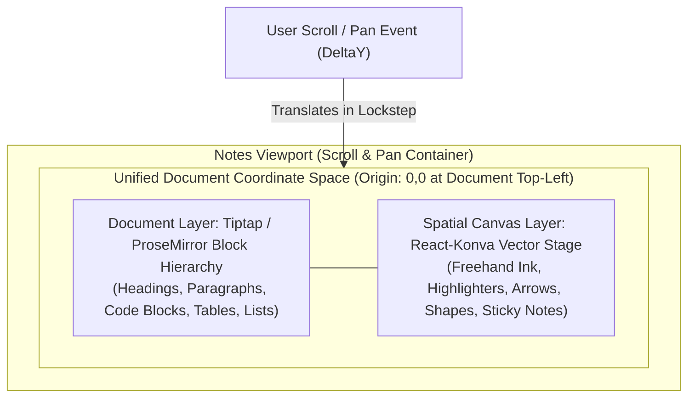
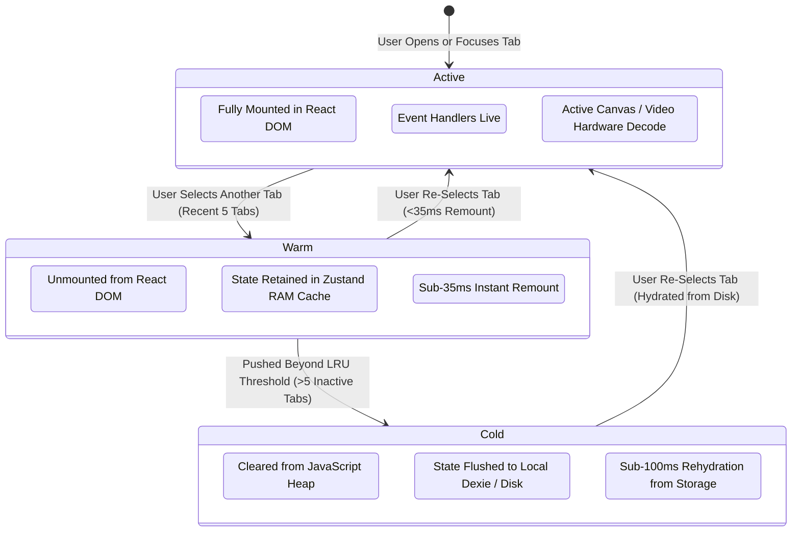
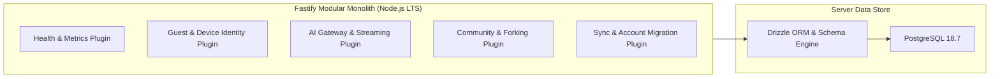
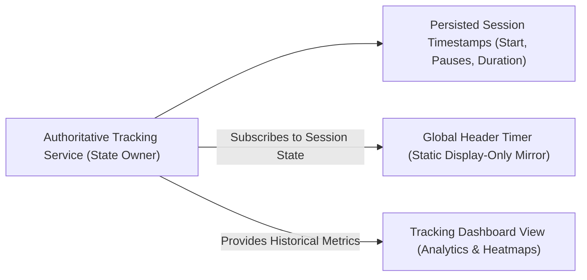

# SOS V3 — Canonical System Architecture Specification

**Status:** Canonical Technical Architecture (Ready for Founder Approval)  
**Version:** 1.0 — November 2026  
**Documentation Baseline:** Post-Audit Canonical Baseline  
**Supersedes & Consolidates:** Previous drafts of `ARCHITECTURE.md`, `ARCHITECTURE_DECISIONS.md`, `PLATFORM_STRATEGY.md`, `FULL_BROWSER_TECHNICAL_REVIEW.md`, `DEPENDENCY_LIBRARY_AUDIT.md`, `TECHNICAL_OPTIONS_REVIEW.md`, `TECHNICAL_DECISION_MATRIX.md`, `TECHNICAL_OPEN_QUESTIONS.md`, `PROTOTYPE_EVIDENCE_AUDIT.md`, `PROTOTYPE_VALIDATION_GAPS.md`, `PROTOTYPE_REFINEMENT_REPORT.md`.

---

## 1. System Overview & Architectural Principles

SOS V3 (**Studying Operating System**) is an integrated learning operating system that unifies academic content ingestion, document-synchronized note-taking, active recall study engines, direct presentation review (native PowerPoint `.pptx` and PDF), embedded research browsing, and context-aware artificial intelligence.

The architecture is founded upon the global **App Shell** hosting **eight primary navigation destinations** accessible via the Left Navigation Rail (56px collapsed / 240px expanded) and Top Global Header (48px).

### Foundational Architectural Principles
1. **Guest-First & Local-First (ADR-002):** Core study functionality operates immediately on local storage without mandatory registration or server dependence. Personal study materials remain locally stored by default.
2. **Modular Eight-Tool Workspace (DEC-001):** Learning orchestrates eight tools (PDF Reader, Slides, Videos, Audios, Browser, Notes, Flashcards, Quiz | Exam). Spatial canvas is integrated across Notes, PDF Reader, and Slides.
3. **Direct Slide Ingestion (DEC-004 & ADR-006):** Slides directly accepts both native PowerPoint (`.pptx`) decks and PDF presentations without requiring manual conversion. A shared Slides product shell delegates to format-specific rendering adapters. Preserving original presentation files without destructive modification is an SOS architectural duty.
4. **Document-Synchronized Canvas (DEC-002, DEC-003, ADR-005):** In Notes, the spatial canvas follows document coordinate movement and scrolling in lockstep. Annotations are stored in zoom-invariant document coordinates, never screen pixels. No artificial fixed-width document constraint is imposed.
5. **Docked Workspace Toolbar (ADR-011 & DEC-011):** The canvas annotation toolbar is fixed and docked at the bottom of the central workspace (`104px` total height). It reserves layout space, never covers content, and is invariant to canvas pan and zoom.
6. **Backend Established in Phase 01 (DEC-012):** The backend is established alongside the initial frontend foundation to provide API routing, service identity, server-side AI provider credentials, quota controls, and migration foundations.
7. **Strict Obsidian Design System (DEC-007):** Full adherence to [DESIGN.md](file:///d:/THE%20DECAGON/OTHER/SOS%20v3/DESIGN.md) (48px header, 56px/240px rail, 340px AI panel, 104px docked toolbar, `#000000` to `#2A2A30` surfaces). (Reviewed from design tokens and specifications).
8. **Tiered Tab Lifecycle (DEC-006 & ADR-004):** Prevents memory leaks by unmounting inactive tabs from the DOM (Warm in RAM cache) and evicting cold tabs to disk (Cold) while maintaining <50ms switch speeds.

---

## 2. Technology Stack & System Responsibilities

### 2.1 Stack Selection Matrix

| Component | Selected Technology | Status | Engineering Rationale |
| :--- | :--- | :--- | :--- |
| **Workspace Architecture** | pnpm Monorepo | `APPROVED` | Strict workspace dependency isolation, shared TypeScript packages (`domain`, `contracts`, `ui`, `editor`), single lockfile. |
| **Frontend Framework** | React 19.3.1 (Stable) | `APPROVED` | Universal component model, high-performance concurrent rendering, zero SSR hydration mismatches. |
| **Language & Typing** | TypeScript 5.8 (Strict) | `APPROVED` | End-to-end type safety across client, desktop, and backend. |
| **Client Bundler** | Vite 8 | `APPROVED` | Sub-100ms HMR, optimized static SPA output directly loadable by Electron and static CDNs. |
| **Desktop Shell** | Electron 45 | `APPROVED` | Native Chromium engine enabling `WebContentsView` for embedded browsing, local filesystem access, and OS window control. |
| **Routing** | TanStack Router | `RECOMMENDED` | Fully type-safe route trees, search parameter validation, and nested layout preservation. |
| **Styling** | Tailwind CSS v4 | `APPROVED` | CSS-first `@theme` block matching obsidian tokens without JavaScript configuration overhead. |
| **Ephemeral UI State** | React State & Zustand 5 | `APPROVED` | Lightweight stores for transient UI states (active tab, tool switcher, modal visibility). RAM is a cache, not source of truth. |
| **Server State Client** | TanStack Query 5 | `RECOMMENDED` | Declarative server data caching, background revalidation, and optimistic updates. |
| **Local Structured Database** | Dexie 4 (IndexedDB) | `APPROVED` | Durable client-side indexed storage for workspaces, notes, flashcards, and annotations across Web and Desktop. |
| **Large Binary Storage (Web)** | OPFS (Origin Private File System) | `APPROVED` | High-speed, private filesystem access for multi-megabyte PDF and video blobs in standard browsers. |
| **Large Binary Storage (Desktop)** | App-Managed Local Filesystem | `APPROVED` | Direct OS disk streaming via Node.js `fs` in the Electron privileged process. |
| **Backend Framework** | Node.js LTS + Fastify 5 | `APPROVED` | High-throughput, low-overhead async server, native TypeScript support, built-in schema validation, SSE streaming. |
| **Server Database** | PostgreSQL 18.7 | `APPROVED` | Active stable major working recommendation (PostgreSQL 18.0 officially released September 25, 2025; current maintenance patch 18.7 released November 12, 2026; https://www.postgresql.org/docs/18/) for server-owned identity, AI usage logs, community metadata, and future sync (subject to hosting environment compatibility). |
| **Server ORM & Migrations** | Drizzle ORM | `APPROVED` | Lightweight TypeScript-first SQL query builder and migration runner with zero runtime bloat. |
| **Validation & Schemas** | Zod 3.24 | `APPROVED` | Universal runtime validation sharing contract schemas between frontend, desktop, and Fastify endpoints. |
| **Document Rich-Text Core** | Tiptap 3 / ProseMirror | `APPROVED` | Headless, block-based structured document engine with versioned JSON serialization. |
| **Vector Drawing Canvas** | Konva 10 / React-Konva 19 | `APPROVED` | High-performance 2D canvas with hardware-accelerated transforms, hit testing, and vector serialization. |
| **PDF Rendering Core** | PDF.js 4.10 (`pdfjs-dist`) | `APPROVED` | Client-side standard for rendering PDF documents and presentation decks via HTML5 Canvas. |
| **PPTX Viewing Core** | Evaluated Presentation SDK | `RECOMMENDED_PENDING_VALIDATION` | Dedicated PowerPoint rendering solution (Nutrient Web SDK as leading candidate, Apryse WebViewer, Syncfusion JavaScript PowerPoint Library, or transparent conversion). |
| **Flashcard Scheduling** | FSRS via `ts-fsrs` | `RECOMMENDED` | Modern Free Spaced Repetition Scheduler delivering higher retention and lower review burden than legacy SM-2. Starts with recommended defaults. |
| **AI Integration Core** | Vercel AI SDK Core | `APPROVED` | Universal streaming and tool-calling abstraction decoupled from Vercel hosting. |
| **AI Initial Provider** | `@ai-sdk/google` (Gemini API) | `RECOMMENDED` | Direct connection to Google Gemini Developer API with server-side API key custody. No AI Gateway required initially. |
| **Testing Framework** | Vitest 3 & Playwright | `APPROVED` | Fast unit testing with Vite compatibility and cross-browser/Electron E2E automation. |

---

## 3. Platform Strategy: Universal Web Core & Desktop Delivery

SOS delivers a cohesive experience across both Web and Desktop targets while respecting platform boundaries:

### Web vs. Desktop Browser Reality
- **Desktop (Electron):** Features a real, fully interactive embedded Chromium browser utilizing `WebContentsView`. Sessions are isolated via `persist:sos_browser`, supporting persistent cookies, navigation restrictions, download routing, security boundaries, and full multi-tab web research without leaving SOS.
- **Web:** Standard browsers enforce `X-Frame-Options: DENY` and `Content-Security-Policy: frame-ancestors` on most academic and commercial sites. The Web version embeds framing-compatible pages directly, and provides a clean External Tab Launcher paired with a Scholarly Reader Mode for sites that prohibit embedding.

---

## 4. Slides & PDF Reader Architecture: Dual Presentation & Document Engines

### 4.1 Separation of Responsibilities
PDF Reader and Slides are distinct learning experiences sharing appropriate underlying services:

| Capability / Dimension | Tool 1: PDF Reader | Tool 2: Slides |
| :--- | :--- | :--- |
| **Supported File Formats** | Ordinary academic PDF documents (textbooks, papers, handouts). | **Both native PowerPoint (`.pptx`) decks and PDF slide presentations.** |
| **User Upload Policy** | Uploads `.pdf`. | **Uploads `.pptx` or `.pdf` directly without manual conversion.** |
| **Rendering Engine** | PDF.js 4.10 (`pdfjs-dist`). | **Dual Adapters:** PDF.js for PDF; evaluated presentation SDK for `.pptx`. |
| **Viewport & Layout Model** | Vertical continuous scrolling or dual-page reading layout. | Centered presentation viewport supporting landscape aspect ratios (16:9 and 4:3). |
| **Navigation Model** | Page scroll, thumbnail sidebar, table of contents, text search. | Slide-by-slide stepping (Prev/Next), arrow keys, visual thumbnail strip, direct slide jump. |
| **Presentation Mode** | Standard document reading view. | **Dedicated Fullscreen Slideshow mode** for distraction-free review. |
| **Spatial Annotations** | Margin gutters for sticky notes & text selection highlights. | Slide-scoped vector ink, highlighters, laser pointer, and notes tied to `page_number`. |
| **Bottom Toolbar Integration** | Fully integrated with **104px Docked Bottom Toolbar**. | Fully integrated with **104px Docked Bottom Toolbar** (0px overlap). |

### 4.2 Mandatory PPTX Technology Evaluation & Comparison

In accordance with founder requirements, direct `.pptx` rendering has been evaluated across leading candidates. Final selection is marked `RECOMMENDED_PENDING_VALIDATION` pending a dedicated validation spike in Phase 06. Preserving original presentation files without destructive modification is an SOS architectural duty.

| Evaluation Criterion | Candidate A: Nutrient Web SDK (formerly PSPDFKit) | Candidate B: Apryse WebViewer (formerly PDFTron) | Candidate C: Syncfusion JavaScript PowerPoint Library | Candidate D: Transparent Internal Conversion |
| :--- | :--- | :--- | :--- | :--- |
| **Direct `.pptx` Input** | Native client-side support via WebAssembly office engine (Office Files licensing component). | Native client-side support via WebAssembly office module (Office Conversion add-on). | Direct client-side loading, editing, and saving of `.pptx` in browser and Electron environments. | Accepts `.pptx`, converts internally to high-DPI cached representation. |
| **Browser & Electron Support** | Full browser support + Electron desktop compatibility. | Full browser support + Electron desktop compatibility. | Compatible with modern browsers and Electron. | Compatible across all targets. |
| **Client vs. Server Processing** | Pure client-side WASM option available (zero server required). | Pure client-side WASM option available (zero server required). | Client-side execution without mandatory server round-trip. | Client-side worker or background backend worker. |
| **External Server Required?** | **No** (standalone client engine available). | **No** (standalone client engine available). | **No** for client library operations. | **No** if using client WASM; **Yes** if using backend worker. |
| **Rendering Fidelity** | High: preserves OOXML shapes, tables, charts, typography, master layouts. | High: industry standard for document/slide fidelity. | Moderate-to-high: accurate text, tables, and shapes; complex charts vary. | High: depends on conversion engine. |
| **Offline Behavior** | **100% Offline** (WASM assets bundled locally). | **100% Offline** (WASM assets bundled locally). | Offline capable when bundled locally. | Offline capable if client worker is used. |
| **Annotation Integration** | Native annotation engine with JSON import/export, adaptable to Konva. | Rich annotation APIs with XFDF/JSON export, adaptable to Konva. | Compatible with custom Konva coordinate overlay. | Native SOS Konva overlay synchronized with slide index. |
| **Original File Preservation** | **Strictly Preserved.** Renders directly from source bytes. | **Strictly Preserved.** Renders directly from source bytes. | **Strictly Preserved.** Direct non-destructive loading. | **Strictly Preserved.** Converted file is cached derived data. |
| **Licensing Model** | Commercial proprietary license. Requires developer agreement. | Commercial proprietary license. Requires developer agreement. | Commercial per-developer or Community License (revenue-capped). | Open-source or lightweight internal service. |
| **Infrastructure Overhead** | Zero server infrastructure. (~30MB WASM client bundle). | Zero server infrastructure. (~40MB WASM client bundle). | Low-to-moderate client bundle. | Requires conversion worker maintenance if server-based. |
| **Architecture Verdict** | **LEADING CANDIDATE (`RECOMMENDED_PENDING_VALIDATION`)** | **STRONG EVALUATED CANDIDATE** | **EVALUATE FOR CLIENT-SIDE FIT** | **VIABLE FALLBACK ARCHITECTURE** |

### 4.3 PowerPoint Scope & Explicit Feature Boundaries
1. **Core Supported Capabilities:** Opening `.pptx` files directly, rendering slide layouts, typography, shapes, tables, charts, images, hyperlinks, slide stepping, visual thumbnail strip, fullscreen viewing, and slide-scoped SOS annotations.
2. **Distinguished / Deferred Capabilities:** Full PowerPoint authoring, complex object entrance/exit animations, timed motion paths, and native multi-screen presenter views are distinguished from core slide study and are deferred.
3. **User Experience Contract:** Users upload `.pptx` files without manual conversion friction. Original files are preserved immutably.

---

## 5. Notes & Spatial Canvas Architecture: Document-Synchronized System

### 5.1 Document-Synchronized Canvas Principle (DEC-002 & DEC-003)
In SOS Notes, the Canvas is **Document-Synchronized**:
- The canvas layer is bound directly to the document coordinate environment.
- When the user scrolls, pans, or navigates vertically through the text document, the canvas stage translates in lockstep with the text.
- The canvas does **not** float as an independent, static screen-fixed overlay.
- No mandatory fixed-width column constraint is imposed on the document layout.

### 5.2 Coordinate Transformation Standards
To ensure annotations survive viewport resizing, zoom operations, and document reopening, spatial data is stored in **Normalized Document Coordinates**:

$$\text{DocX} = \frac{\text{PointerX} - \text{StageOffsetX}}{\text{ZoomScale}}, \quad \text{DocY} = \frac{\text{PointerY} - \text{StageOffsetY} + \text{ScrollTop}}{\text{ZoomScale}}$$

When re-rendering at any arbitrary scale and scroll position:
$$\text{ScreenX} = (\text{DocX} \times \text{ZoomScale}) + \text{StageOffsetX}$$
$$\text{ScreenY} = (\text{DocY} \times \text{ZoomScale}) + \text{StageOffsetY} - \text{ScrollTop}$$

### 5.3 Text Reflow Policy & Coordinate Boundaries
To resolve spatial consistency across document editing, layout changes, and freehand drawing, SOS defines clear coordinate boundaries:

1. **Coordinate Hierarchy & Separation:**
   - **Viewport / Screen Coordinates ($$\text{ScreenX}, \text{ScreenY}$$):** Ephemeral device pixel locations relative to the active browser window and Stage viewport. Never persisted.
   - **Document-Relative Coordinates ($$\text{DocX}, \text{DocY}$$):** Normalized 2D canvas coordinates anchored strictly to the top-left origin ($$0, 0$$) of the document scroll container. Persistent and invariant to zoom scale, pan translation, and scroll offset.
2. **Document Reflow Behavior (Baseline Architecture):**
   - **Absolute Document Anchoring:** Vector drawings, freehand ink, highlighters, and shapes are rendered onto the Konva stage at their document-relative coordinates ($$\text{DocX}, \text{DocY}$$).
   - **Wide Margin Layout:** Notes documents employ a responsive wide-margin layout. Students are encouraged to use margins for diagrams, callout annotations, and freehand summaries. Content placed in margins remains unaffected by body text wrapping.
   - **Text Insertion Above Marks:** When text is added or deleted above existing annotations, or when line breaks change due to viewport resizing, spatial marks retain their absolute document coordinates. The document scroll container expands downward, and marks maintain their spatial relationship to the document canvas space.
3. **Semantic Block Anchoring (Explicitly Deferred Post-v1):**
   - Dynamically binding vector strokes to individual ProseMirror block node IDs (`data-block-id` UUIDs) or text character offsets—so that strokes shift downward automatically when paragraphs are inserted above—is recognized as an advanced reflow capability.
   - To avoid excessive CPU overhead, coordinate jitter, and spatial distortion during active typing, semantic block anchoring is **explicitly deferred to post-v1 releases**.
4. **Separation of History Stacks:**
   - The Tiptap text editor and Konva vector canvas maintain completely independent undo/redo history stacks.
   - Keyboard shortcuts (`⌘Z`, `⇧⌘Z`) target the currently active or focused layer (editor text vs. canvas drawing tool).

---

## 6. Multi-Tab State Architecture & Tiered Lifecycle

To support 30+ open tabs without browser tab crashes or memory exhaustion, SOS implements a three-tier lifecycle:

### Concrete Lifecycle Rules
1. **Active Tier (Strict Limit: 1):** The currently visible, interactive tool.
2. **Warm Tier (Limit: 5 Tabs):** Retained in Zustand memory for instantaneous remounting. Heavy DOM elements are unmounted.
3. **Cold Tier (Unbounded):** Inactive tabs beyond the 5 most recent flush their state to local storage (Dexie / filesystem) and free their memory footprint. Clicking a Cold tab rehydrates state in sub-100ms.
4. **Persistent Shell Audio Singleton:** When switching tabs, audio playback **continues uninterrupted** via a shell-level audio manager. Changing tabs never kills audio.

---

## 7. Backend & API Architecture (Established in Phase 01)

### 7.1 Role and Scope of the Backend
The backend begins in **Phase 01** as an integral part of the architecture:
- **Modular Monolith:** Single Fastify application with cleanly defined internal domain plugins (`auth`, `ai`, `community`, `sync`, `health`).
- **Local-First Boundary:** The backend does **not** store all personal learning content. Notes, PDFs, and local study files remain local by default.
- **Backend Responsibilities:**
  1. Secure API routing with runtime Zod validation and auto-generated OpenAPI documentation.
  2. Guest/device service identity registration without forced accounts.
  3. Server-side custody of AI provider credentials (Gemini API keys).
  4. AI request proxying, context transmission, SSE streaming, and quota enforcement.
  5. PostgreSQL 18.7 database migrations and health monitoring.
  6. Optional cloud accounts and future synchronization foundations.

---

## 8. Artificial Intelligence Architecture (Google Gemini + Vercel AI SDK Core)

### 8.1 Product Experience
- **Persistent AI Panel:** Positioned on the right side of the workspace (~340px wide), collapsible via keyboard shortcut (`⌘J`).
- **Dynamic Model Selector:** The UI displays a selector populated dynamically from the backend Model Registry (with generic placeholder "Select Model" / "Available Models").
- **Context-Aware Workflows:** Slash commands (`/explain`, `/summarize`) and contextual mentions (`@file`, `@slides`, `@selection`).
- **User-Approved Context Selection:** Only user-selected document excerpts or active slide text are submitted to the model. SOS never transmits the entire library or unselected notes.
- **Provider Transparency:** Clear visual indication of the active model and data destination before sending requests.

### 8.2 Technical Implementation
- **Vercel AI SDK Core:** Selected as the universal model-agnostic streaming and tool-calling library. (Decoupled from Vercel hosting).
- **Google Gemini Provider:** `@ai-sdk/google` connecting directly to the Google Gemini Developer API.
- **No AI Gateway Initially:** Direct provider calls from Fastify backend; Vercel AI Gateway is not required.
- **Quota & Protection Rules:**
  - API keys remain strictly on the backend. Client bundles never contain provider secrets.
  - Rate limiting and usage quotas tracked per device/guest.
  - **No Silent Paid Fallback:** When free quota is exhausted, the UI displays a clear explanation, preserves the conversation, and offers retry options. SOS never silently switches users to paid billing.
  - **BYOK (Bring Your Own Key):** Not mandatory for ordinary users. May be offered as an optional advanced setting in the future.

---

## 9. Data Architecture & Storage Boundaries

### 9.1 Local vs. Server Data Separation

| Storage Location | Engine | Managed Entities | Ownership & Persistence Rules |
| :--- | :--- | :--- | :--- |
| **Local Structured Store** | Dexie 4 (IndexedDB) | `workspaces`, `folders`, `library_resources`, `documents`, `canvas_annotations`, `flashcards`, `quizzes`, `tracking_sessions`, `calendar_events` | 100% locally owned. Persists offline across reboots and browser refreshes. Primary source of truth. |
| **Local Binary Store (Web)** | OPFS (Origin Private File System) | PDF files, PPTX decks, video blobs, audio recordings | Streamed directly into memory; isolated from standard DOM heap. |
| **Local Binary Store (Desktop)** | App-Managed Filesystem | PDF files, PPTX decks, video files, local exports | Direct OS file path storage managed by Electron main process. |
| **Server Database** | PostgreSQL 18.7 via Drizzle ORM | `users`, `device_registrations`, `ai_usage_logs`, `model_configs`, `community_resources`, `fork_records`, `sync_metadata` | Server-owned metadata, quotas, and optional account synchronization data (subject to hosting environment compatibility). |

### 9.2 Stable Identifier Standard
All user-created entities use locally generated **UUIDv7** identifiers. UUIDv7 guarantees global uniqueness without network roundtrips while preserving natural chronological sortability.

---

## 10. Tracking & Header Timer Architecture

- **Single Authority:** Tracking owns all study session timers, pause intervals, and focus metrics.
- **Display Mirror:** The Header Timer is a display-only mirror. It does not run independent intervals and cannot drift; elapsed time is computed mathematically from persisted timestamps ($$\text{Elapsed} = \text{Now} - \text{Start} - \sum \text{PauseIntervals}$$).

---

## 11. Community & Independent Copy Forking

When a user forks a resource from the Community:
1. An **independent copy** of the resource is instantiated inside the user's personal Library.
2. The new resource is assigned a new UUIDv7 and owned entirely by the receiving user.
3. The user can edit, annotate, or delete it freely without affecting the original.
4. An immutable **provenance snapshot** (original author name, source resource ID, version hash, timestamp) is recorded.
5. Updates or deletions of the source resource never overwrite or break the fork.

---

## 12. Security, Privacy & Desktop Hardening

1. **Local-First Privacy:** In Guest Mode, zero personal study data leaves the device.
2. **Electron Hardening Standards:**
   - `nodeIntegration: false`, `contextIsolation: true`, `sandbox: true`.
   - IPC communication strictly gated through typed channels in `preload.ts`.
   - Navigation restricted via `webContents.setWindowOpenHandler` and `will-navigate`.
3. **Document Security:**
   - PDF and PPTX packages parsed as untrusted binary input.
   - ZIP decompression limits (zip-bomb protection) and path traversal checks.
   - Script execution inside embedded documents strictly disabled.
4. **AI Safety:**
   - Prompt injection defenses: document text demarcated as untrusted data.
   - Tool calling uses strict JSON schemas; mutating tools require user confirmation.

---

## 13. Canonical Architectural Decision Records (ADRs)

| ADR ID | Decision Title | Status | Summary & Governing Architectural Rule |
| :--- | :--- | :--- | :--- |
| **ADR-001** | Monorepo & Framework | `APPROVED` | pnpm workspace with React 19 + TypeScript 5.8 + Vite 8 in modular structure (`apps/web`, `apps/desktop`, `apps/api`, `packages/*`). |
| **ADR-002** | Guest-First Access Policy | `APPROVED` | Full functionality in Guest Mode via local Dexie/OPFS; optional cloud accounts with atomic non-destructive migration. |
| **ADR-003** | Hybrid Web + Desktop Strategy | `APPROVED` | Universal Web SPA core; Desktop uses Electron 45 with `WebContentsView` for embedded browsing and native filesystem. |
| **ADR-004** | Tiered Tab Lifecycle | `APPROVED` | Three-tier lifecycle: Active (1 in DOM), Warm (5 in RAM cache), Cold (>5 flushed to local storage) to prevent memory crashes. |
| **ADR-005** | Document-Synchronized Canvas | `APPROVED` | Notes canvas translates in lockstep with document scrolling; annotations use normalized document coordinates ($$\text{DocX}, \text{DocY}$$). No forced fixed-width constraint. |
| **ADR-006** | Direct PPTX & PDF Slides Ingestion | `APPROVED` | Slides accepts both native `.pptx` and `.pdf` without manual user conversion. PDF.js renders PDF; dedicated presentation SDK renders PPTX. Preserving original files is an architectural duty. |
| **ADR-007** | Persistent Shell Audio Singleton | `APPROVED` | Audio player operates at shell level, persisting playback across tab switches. Video auto-pauses on unmount. |
| **ADR-008** | Native View Visibility Coordinator | `APPROVED` | Solves Electron window layering: main process automatically hides `WebContentsView` when HTML modals or drawers open. |
| **ADR-009** | Unified Quiz \| Exam Assessment | `APPROVED` | Quiz \| Exam is one unified assessment tool; an individual Assessment may have its own configuration (such as optional time limit, question shuffling/ordering, or feedback timing) applied directly to the assessment itself without any Quiz vs Exam distinction; FSRS (`ts-fsrs`) preferred for flashcards. |
| **ADR-010** | Context-Aware AI Panel | `APPROVED` | Persistent ~340px right drawer. Google Gemini initial candidate via Fastify backend. Vercel AI SDK Core. Dynamic model selection. No silent paid fallback. |
| **ADR-011** | Docked Workspace Bottom Toolbar | `APPROVED` | Canvas annotation toolbar is fixed and docked at workspace footer (104px height), reserves layout space, and is invariant to canvas pan/zoom. |
| **ADR-012** | Backend Established in Phase 01 | `APPROVED` | Node.js LTS + Fastify 5 + PostgreSQL 18.7 + Drizzle modular monolith established in Phase 01 alongside frontend foundations. |
| **ADR-013** | Library Flexible Folders | `APPROVED` | User-defined flexible folder hierarchy with Gallery, List, and Table views; no forced rigid taxonomy. |
| **ADR-014** | Tracking as Single Authority for Timer | `APPROVED` | Tracking owns the session; Header Timer is a static display mirror computing elapsed time from persisted timestamps. |
| **ADR-015** | Community Independent Forking | `APPROVED` | Forking creates an independent copy in the user's Library with provenance snapshot and independent ownership. |

---

## 14. Remaining Unresolved Decisions & Execution Gates

| Gate ID | Scope & Question | Scheduled Phase | Risk & Resolution Strategy |
| :--- | :--- | :--- | :--- |
| **DG-01** | **PPTX Rendering SDK Selection Spike:** Evaluate Nutrient Web SDK (Office Files component) vs. Apryse WebViewer (Office Conversion add-on) vs. Syncfusion JavaScript PowerPoint Library vs. transparent conversion for fidelity, bundle size, and licensing. | Phase 04 (Subphase 4.4: Slides) | Medium risk; isolated validation spike will measure rendering fidelity and licensing terms before finalizing production SDK. |
| **DG-02** | **Desktop Electron Final Sign-Off:** Verify session isolation, persistent cookie handling, navigation restrictions, download routing, and security boundaries in `WebContentsView`. | Phase 04 (Subphase 4.6: Browser) | Low risk; fallback to external tab launcher is already fully implemented. |
