# SOS V3 — Design System & Visual Specification

**Status:** Canonical Visual & Interaction Design Specification  
**Baseline Source:** Authoritative Google Stitch Project (`projects/1366384921760863805`, "Studying Operating System UX Architecture", specifically verified against the latest canonical screen `node_12800577758894789895` "Learning — Notes").  
**Design Principles:** Obsidian Dark, Restrained Contrast, Three-Island Shell, 104px Docked Toolbar Alignment, Focus-First Scholarly Workspace.

---

## 1. Design Philosophy & Core Tenets

The visual and spatial design of SOS V3 is built on five core tenets:
- **Obsidian Dark Theme**: Grounded on absolute pitch-black (`#000000`) and deep obsidian zincs (`#09090B`, `#0C0C0E`, `#141417`).
- **Restrained Grayscale**: Saturated colors are strictly avoided except for deliberate semantic accents (e.g. orange pulse timer, green success badges, or subtle academic ink swatches).
- **Three-Island Shell**: The entire application viewport is structured into three floating rounded "islands" separated by an 8px uniform spatial gap.
- **Micro-Interactions & Spring Transitions**: Dynamic components utilize cubic-bezier spring curves (`cubic-bezier(0.16, 1, 0.3, 1)`) and fine-grained subtle hover states (`rgba(255, 255, 255, 0.05)`).
- **Distraction-Free Scholarly Focus**: Spacing, typography, and contrast prioritize intense academic reading, synthesis, and deep work.

---

## 2. Color Palette & Surface Tokens

### 2.1 Surfaces & Backgrounds
| Token Name | Hex / Value | Usage |
| :--- | :--- | :--- |
| `sos-base` | `#000000` | Canvas base, global viewport background |
| `sos-sidebar` | `#09090B` | Left navigation rail, right AI panel background, central workspace base |
| `sos-surface1` | `#0C0C0E` | Island top headers and secondary surface layer |
| `sos-surface2` | `#141417` | Card backgrounds, pill badges, and elevated containers |
| `sos-surface3` | `#1C1C21` | Tooltips, popovers, and elevated modal panels |
| `sos-hover` | `rgba(255, 255, 255, 0.05)` | Default hover state across buttons and list items |
| `sos-active` | `rgba(255, 255, 255, 0.09)` | Active / pressed state across controls |

### 2.2 Borders & Dividers
| Token Name | Hex / Value | Usage |
| :--- | :--- | :--- |
| `sos-borderSubtle` | `#222226` | Outer boundary border of the 3 floating islands |
| `sos-borderDefault` | `#2A2A30` | Standard component border, tab dividers, input borders |
| `sos-borderStrong` | `#3F3F46` | High-contrast borders, active pill borders, modal borders |
| `sos-borderInteractive` | `#52525B` | Hovered interactive elements |
| `sos-borderFocus` | `#FAFAFA` | Active keyboard focus rings |

### 2.3 Typography & Foreground Colors
| Token Name | Hex / Value | Usage |
| :--- | :--- | :--- |
| `sos-primary` | `#FAFAFA` | Headings, active icons, primary titles |
| `sos-secondary` | `#A1A1AA` | Body copy, secondary titles, inactive tab labels |
| `sos-muted` | `#71717A` | Metadata, shortcut badges, timestamps, subtle borders |
| `sos-disabled` | `#4B4B52` | Disabled buttons and non-interactive icons |
| `sos-placeholder` | `#63636B` | Input field placeholders |

### 2.4 Semantic Accents
| Token Name | Hex / Value | Usage |
| :--- | :--- | :--- |
| `sos-pomodoro` | `#F97316` | Active Pomodoro timer pulse, high-yield alert indicators |
| `sos-success` | `#68D391` / `#16A34A` | Completed tasks, streak milestones, verified answers |
| `sos-error` | `#E57373` / `#DC2626` | Incorrect answers, destructive actions |
| `sos-warning` | `#ED8936` / `#D97706` | Pending reviews, deadline countdown warnings |
| `sos-info` | `#76A9FA` / `#3B82F6` | Academic links, selected references |

### 2.5 Academic Ink Swatches (Canvas Layer)
The two-tier docked bottom toolbar specifies 5 muted academic ink colors:
1. **Off-White**: `#F4F4F5` / `#FAFAFA` (default drawing stroke)
2. **Muted Amber**: `#D97706` / `#B45309` (highlighting & key points)
3. **Terracotta**: `#DC2626` / `#991B1B` (clinical alerts & errors)
4. **Slate Blue**: `#3B82F6` / `#1D4ED8` (diagram connectors & structures)
5. **Sage Green**: `#16A34A` / `#15803D` (definitions & confirmed knowledge)

---

## 3. Typography Standards

- **Sans-Serif (Primary UI & System)**:
  `'Inter', 'IBM Plex Sans Arabic', -apple-system, BlinkMacSystemFont, sans-serif`
  Used for all UI chrome, navigation, toolbars, buttons, tables, and system dialogs.
- **Monospace (Data, Code, & Tabular Metrics)**:
  `'JetBrains Mono', monospace`
  Used for timers (`tnum`), timestamps, source code blocks, and math equations.

### Type Scale
| Level | Font Size | Line Height | Font Weight | Letter Spacing |
| :--- | :--- | :--- | :--- | :--- |
| Display | 26px - 28px | 1.2 | 700 (Bold) | -0.02em |
| Heading 1 | 20px - 22px | 1.3 | 650 (SemiBold) | -0.015em |
| Heading 2 | 16px - 18px | 1.4 | 600 (SemiBold) | -0.01em |
| Body Large | 14px - 15px | 1.5 | 400 (Regular) | 0 |
| Body Standard | 13px - 13.5px | 1.5 | 400 / 500 | 0 |
| Label / Control | 12px - 12.5px | 1.2 | 500 / 600 | 0.01em |
| Caption / Micro | 10.5px - 11px | 1.2 | 500 (Medium) | 0.02em |

---

## 4. Spacing, Geometry & Radii

### 4.1 Border Radii
```css
--radius-sos-micro:     10px;   /* Small pills, tooltips, sub-controls */
--radius-sos-control:   14px;   /* Buttons, inputs, search bar, active tab pill */
--radius-sos-card:      18px;   /* Content cards, callouts, list tiles */
--radius-sos-island:    24px;   /* Left rail, central workspace, right AI panel */
--radius-sos-modal:     28px;   /* Modal dialogs, split-screen auth */
--radius-sos-toolbar:   14px;   /* Docked toolbar inner controls */
--radius-sos-pill:      9999px; /* Badges, counters, round action buttons */
```

### 4.2 Elevation & Box Shadows
- **Island Shell**: `0 12px 40px rgba(0, 0, 0, 0.60)`
- **Floating Controls / Popovers**: `0 8px 32px rgba(0, 0, 0, 0.70)`
- **Modals & Overlays**: `0 24px 64px rgba(0, 0, 0, 0.85)`

### 4.3 Z-Index Layer Hierarchy
```javascript
zIndex: {
  'sos-base': '0',
  'sos-floating-block': '10',
  'sos-canvas-layer': '20',
  'sos-docked-toolbar': '30',
  'sos-shell-surface': '35',
  'sos-split-divider': '40',
  'sos-dropdown': '100',
  'sos-modal-backdrop': '200',
  'sos-modal': '210',
  'sos-toast': '300',
  'sos-tooltip': '400',
}
```

---

## 5. Three-Island Layout Anatomy

The overall viewport layout is divided into three coordinated islands hosted within the App Shell, providing seamless access to the **eight primary navigation destinations** (Home, Library, Learning, Tracking, Calendar, Community, Profile, Settings):

```
┌──────────────┬────────────────────────────────────────────┬──────────────┐
│  LEFT RAIL   │             CENTRAL WORKSPACE              │   AI PANEL   │
│  (56px /     │                  (flex-1)                  │   (340px)    │
│   240px)     │                                            │              │
├──────────────┼────────────────────────────────────────────┼──────────────┤
│ 48px Header  │ 48px Header (Tabs / Breadcrumb + Controls) │ 48px Header  │
├──────────────┼────────────────────────────────────────────┼──────────────┤
│ 8 Nav Icons  │ Content Viewport (flex-1)                  │ Conversation │
│ Rail         │ (Document / Player / Canvas / Cards / Tool)│ Stream       │
│              │                                            │              │
├──────────────┼────────────────────────────────────────────┼──────────────┤
│ 104px Bottom │ DOCKED FULL-WIDTH BOTTOM TOOLBAR           │ Bottom Input │
│ Utilities    │ (104px height, 2-tier docked workspace bar)│ Dock         │
└──────────────┴────────────────────────────────────────────┴──────────────┘
```

1. **Outer Viewport**: `padding: 8px` (`p-2`), background `#000000`.
2. **Gap Between Islands**: `8px` (`gap-2`).
3. **Left Navigation Rail**:
   - Collapsed (Default): `56px` fixed width.
   - Expanded: `240px` (or `260px` in Library tree view).
   - Top Brand Header: `48px` height with circular expand trigger.
   - Middle Stack: Eight Navigation icon buttons (`w-10 h-10`).
   - Bottom Utility Stack: `104px` height housing Settings button (`w-10 h-10`) and User Profile Avatar (`w-8 h-8`).
4. **Central Workspace Island**:
   - `flex-1 min-w-0`, background `#09090B`, border `#222226`, radius `24px`.
   - Top Bar: Exact `48px` height, border-b `#222226`. Left contains breadcrumbs or tab pills; right contains Search (`⌘K`), Messages, Notifications, Full Screen, and Global Timer Pill (`🟠 24:18`).
   - Content Viewport: `flex-1 overflow-auto`, dedicated to the active tool.
   - Docked Bottom Toolbar: Exact `104px` total height, full-width docked footer aligned with the 104px Left Rail utility area.
5. **Right AI Assistant Panel**:
   - `w-[340px]` fixed width, collapsible via `⌘J`.
   - Top Bar: Exact `48px` height with Tab badge, `+` New Chat, History clock, Full Screen, Collapse icon.
   - Middle Chat Stream: Scrollable conversation with context badges.
   - Bottom Input Dock: Context row, 14px rounded input container, Dynamic Model Selector displaying available models from backend Model Registry (with generic placeholder "Select Model" / "Available Models"), Paperclip attachment icon, Send button.

---

## 6. Shared Component Specifications

### 6.1 Docked Full-Width Bottom Toolbar (104px Authoritative Geometry)
Used across **Learning — Notes**, **Learning — PDF**, and **Learning — Slides**, verified directly from the authoritative Google Stitch screen `node_12800577758894789895`:

```mermaid
flowchart TD
    subgraph DockedToolbarContainer ["Docked Bottom Toolbar (w-full, h-[104px], #09090B, border-t #1F1F23, flex-col justify-center, z-30)"]
        subgraph Tier1 ["Tier 1: Active Pen Options Row (h-10 / 40px, border-b #1F1F23/60, flex items-center justify-center gap-3)"]
            T1_Weights["3 Stroke Weights (Fine 2px, Medium 4px Active Pill, Thick 6px)"]
            T1_Div1["Divider (w-px h-3.5 #27272A)"]
            T1_Colors["5 Ink Swatches (Off-White, Amber, Terracotta, Slate Blue, Sage Green)"]
        end

        subgraph Tier2 ["Tier 2: Primary Annotation Tools Row (h-11 / 44px, pt-0.5, flex items-center justify-center gap-1)"]
            T2_Nav["1. Select (V) | 2. Hand / Pan (H)"]
            T2_Div1["Divider (w-px h-4 #27272A)"]
            T2_Draw["3. Pen (P) [Active] | 4. Highlighter (H) | 5. Eraser (E) | 6. Laser Pointer (L)"]
            T2_Div2["Divider (w-px h-4 #27272A)"]
            T2_Obj["7. Shapes Dropdown (S) | 8. Arrow Dropdown (A) | 9. Text Box (T)"]
            T2_Div3["Divider (w-px h-4 #27272A)"]
            T2_History["10. Undo (Cmd+Z) | 11. Redo (Cmd+Y)"]
        end
    end

    Tier1 --> Tier2
```



#### Exact Geometry, Layout & Alignment (Stitch Verified)
- **Stitch Reference:** Screen `node_12800577758894789895` ("Learning — Notes"), `<footer id="docked-bottom-bar">`.
- **Placement:** Docked at the bottom of the central workspace container (`footer#docked-bottom-bar`).
- **Dimensions:** Width `100%` (spans full width of the central island), Height exactly `104px` (`h-[104px]`, `shrink-0`).
- **Visual Styling:** Background `#09090B`, top border `1px solid #1F1F23`, horizontal padding `px-4`, `flex flex-col justify-center select-none z-30`.
- **Vertical Alignment:** Perfectly aligns horizontally with the `104px` Bottom Utility Stack of the Left Navigation Rail (`<div class="h-[104px] flex flex-col items-center justify-center">`).
- **Space Reservation:** The document/presentation content area sits directly above it with `flex: 1`, reserving the 104px vertical height. The toolbar **never covers** document text, PDF pages, or slide canvases.
- **Canvas / Pan / Zoom Invariance:** The toolbar is part of the workspace shell, **not** a canvas object. Canvas panning and zooming have **zero effect** on toolbar position, scale, or rendering.
- **Responsive Behavior:** When the Left Navigation Rail expands (56px to 240px) or the AI Assistant Drawer opens/closes (340px), the central workspace container resizes, and the docked toolbar resizes synchronously across the full width with smooth CSS transitions.

#### Internal Two-Tier Structure & Discrepancy Resolution
The previous documentation noted an apparent arithmetic discrepancy ($$40\text{px} + 44\text{px} = 84\text{px} \neq 104\text{px}$$). Direct inspection of the authoritative Stitch HTML establishes the exact implementation:
1. **Tier 1 (Active Pen Options Row):** `h-10` (`40px`), `flex items-center justify-center gap-3 border-b border-[#1F1F23]/60 px-2`.
   - *Stroke Weights (3 circular dots):* Fine 2px dot (`#A1A1AA`), Medium 3.5px dot (`#F4F4F5`) enclosed in an active 20x20px pill (`bg-[#222227]`, border `1px solid #323238`), Thick 5px dot (`#A1A1AA`).
   - *Divider:* Vertical rule `1px x 14px` (`bg-[#27272A]`).
   - *5 Academic Ink Swatches:* 14x14px circular buttons: Off-White (`#F4F4F5`, ring `1.5px #71717A`, ring-offset `1px #09090B`), Muted Amber (`#D97706`), Terracotta (`#DC2626`), Slate Blue (`#3B82F6`), Sage Green (`#16A34A`).
2. **Tier 2 (Primary Annotation Tools Row):** `h-11` (`44px` with `pt-0.5` padding-top), `flex items-center justify-center gap-1 text-sos-secondary pt-0.5`.
   - *Navigation Group:* 1. Selection Pointer (`mouse-pointer`, V, 28x28px `w-7 h-7`), 2. Hand / Pan (`hand`, H, `w-7 h-7`).
   - *Divider:* Vertical rule `1px x 16px` (`bg-[#27272A] mx-1`).
   - *Drawing Tools Group:* 3. Draw / Pen Active (`pen-tool`, P, `h-7 px-2.5 rounded-md bg-[#222227] border border-[#323238] text-[#F4F4F5]`), 4. Highlighter (`highlighter`, H, `w-7 h-7`), 5. Eraser (`eraser`, E, `w-7 h-7`), 6. Laser Pointer (`svg` ray icon, L, `w-7 h-7`).
   - *Divider:* Vertical rule `1px x 16px` (`bg-[#27272A] mx-1`).
   - *Objects Group:* 7. Shapes Dropdown (`square` + `chevron-down`, S, `h-7 px-2`), 8. Arrow / Connector Dropdown (`arrow-up-right` + `chevron-down`, A, `h-7 px-2`), 9. Text Box (`type`, T, `w-7 h-7`).
   - *Divider:* Vertical rule `1px x 16px` (`bg-[#27272A] mx-1`).
   - *History Group:* 10. Undo (`undo-2`, Cmd+Z, `w-7 h-7`), 11. Redo (`redo-2`, Cmd+Y, `w-7 h-7`).
3. **Exact Vertical Centering:** The two tool rows occupy `84px` content height ($$40\text{px} + 44\text{px} = 84\text{px}$$). The container applies `flex flex-col justify-center`, which automatically centers the two rows vertically within the `104px` total height, resulting in balanced $$10\text{px}$$ top and bottom vertical breathing margins ($$10\text{px} + 40\text{px} + 44\text{px} + 10\text{px} = 104\text{px}$$).

---

### 6.2 Notion-Style Document Engine
Used in **Library** and **Learning — Notes (Document Layer)**:
- 150px height full-bleed cover banner with subtle bottom dark gradient.
- Overlapping Emoji icon badge (`mt-[-28px]`, `w-14 h-14` rounded-2xl).
- Document title, description, and metadata tags.
- Block types: Headings (H1/H2/H3), paragraphs, Callout Boxes (Key Point, Clinical Alert, Mnemonic), Gallery/List/Table resource cards, and floating spatial notes.

---

### 6.3 Authentication Split Container
Used across auth screens (accessible from Profile / Settings):
- Floating centered modal container: `max-w-[980px]`, `rounded-28px`, border `#27272A`.
- 50/50 split:
  - Left: Minimalist black-and-white architectural/scholarly photography with obsidian readability gradient overlay, S [book] S logo mark, headline, and 3 value-proposition bullet points.
  - Right: Clean sign-in / registration form card with segmented switcher, input fields, social auth (Google, Apple, GitHub), and submit buttons.

---

### 6.4 Document-Synchronized Notes & Canvas Interaction
In **Learning — Notes**, the Spatial Canvas is **document-synchronized**:
- The canvas layer is bound to the document's coordinate environment and movement.
- When the user scrolls, pans, or navigates vertically through the text document, the canvas stage translates in lockstep with the document text.
- Annotations (drawings, ink strokes, sticky notes) are stored in document-relative coordinates rather than fixed viewport/screen pixels.
- The canvas does NOT float as an independent static screen overlay; it behaves as a natural drawing layer over the flowing scholarly document.
- No artificial fixed-width column constraint is imposed on the document layout.

---

## 7. Accessibility Standards (WCAG 2.2 AA)

SOS adheres to the **WCAG 2.2 AA** working accessibility baseline across both Web and Desktop platforms:
1. **Color Contrast:**
   - Primary text (`#FAFAFA`) on dark surfaces (`#000000`, `#09090B`) exceeds `14:1` contrast ratio (well above the 4.5:1 AA requirement).
   - Secondary text (`#A1A1AA`) exceeds `5.8:1`.
   - Subtle interactive borders (`#52525B`) provide distinct visibility against dark island surfaces.
2. **Keyboard Navigation & Focus Management:**
   - Visible, high-contrast focus rings (`outline: 2px solid #FAFAFA`, `outline-offset: 2px`) for all interactive buttons, inputs, tabs, and menu items.
   - Comprehensive keyboard shortcuts (`⌘K` search, `⌘J` AI toggle, `V` select, `H` hand, `P` pen, `E` eraser, arrow navigation in Slides).
   - Full keyboard accessibility for the 104px Docked Toolbar and slide steppers.
3. **Motion & Vestibular Safeguards:**
   - Supports `prefers-reduced-motion: reduce`: all cubic-bezier spring animations and slide transitions gracefully fall back to instantaneous or simple opacity fades.
4. **Screen Reader Semantics:**
   - Proper ARIA landmarks (`banner`, `navigation`, `main`, `complementary`, `contentinfo`).
   - Descriptive `aria-label` tags for icon-only toolbar buttons (e.g. "Select Tool (V)", "Pen Tool (P)", "Toggle Fullscreen").
   - Slide index and tracking timer announcements via live regions where appropriate.
