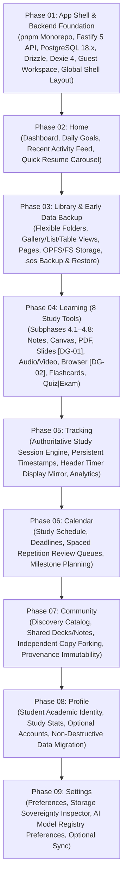
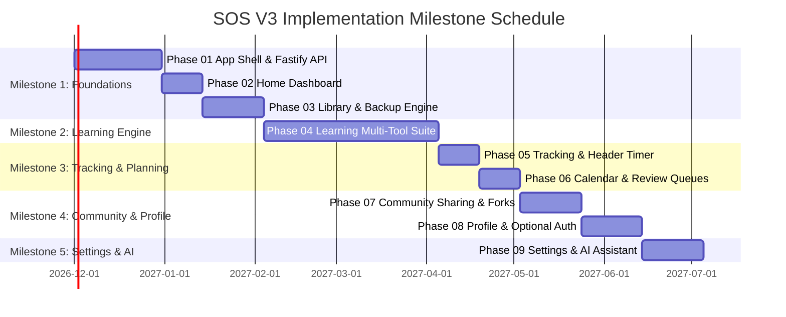

# SOS V3 — Canonical Product Implementation Roadmap

**Status:** Canonical Implementation Plan (Ready for Founder Approval)  
**Version:** 1.0 — November 2026  
**Documentation Baseline:** Post-Audit Canonical Baseline  
**Supersedes & Consolidates:** `POC_EXECUTION_PLAN.md`, `PROTOTYPE_REFINEMENT_REPORT.md` (roadmap sections), `TECHNICAL_OPTIONS_REVIEW.md` (scheduling sections).

---

## 1. Implementation Philosophy & Architecture Alignment

The SOS V3 implementation roadmap is organized into **nine primary phases** following the exact product architecture: the foundational **App Shell** followed by the **eight primary navigation destinations** in the exact order established by the Left Navigation Rail:

$$\text{App Shell} \longrightarrow \text{Home} \longrightarrow \text{Library} \longrightarrow \text{Learning} \longrightarrow \text{Tracking} \longrightarrow \text{Calendar} \longrightarrow \text{Community} \longrightarrow \text{Profile} \longrightarrow \text{Settings}$$



### Core Implementation Principles
1. **Vertical Slices with Immediate Value:** Each phase delivers an end-to-end usable section of the operating system.
2. **Backend Established in Phase 01 (ADR-012):** The Fastify 5 + PostgreSQL 18.x (PostgreSQL 18 major-version baseline; local environment verified with 18.6, patch versions updateable at implementation time) backend begins on day one alongside the client shell. It is never deferred to an afterthought.
3. **Local-First & Guest-First Core (ADR-002):** The client initializes immediately into an isolated Guest workspace backed by Dexie 4 (IndexedDB) on the web and local filesystem on desktop. Network connectivity is never a prerequisite for core study activities.
4. **Early Data Portability (Phase 03):** Local workspace backup, export, and restore (`.sos` / ZIP archive) are implemented early in Phase 03 alongside the Library, ensuring users can safeguard their data before heavy multi-tool content generation begins in Phase 04.
5. **Contextual Toolbar Scope:** The verified 104px docked toolbar belongs specifically to canvas-enabled Learning tools (Notes, PDF Reader, Slides). The App Shell provides a flexible workspace layout composition without forcing an unnecessary 104px global reservation across non-canvas views (Home, Library, Tracking, Calendar, Community, Profile, Settings).
6. **Rigorous Decision Gates (`DG-01`, `DG-02`):** Complex third-party integrations (such as the direct PPTX presentation engine and native embedded browser) follow formal decision gates with defined evaluation criteria.
7. **Complete Pinned Dependency Foundation Pre-Installed:** All approved direct dependencies across the entire 9-phase architecture (Tiptap 3.34.0, Konva 10.9.1, PDF.js 6.5.438, ts-fsrs 6.0.0, JSZip 3.10.2, KaTeX 0.19.1, Vercel AI SDK Core 7.0.173, Google Provider 4.0.121, Vitest 5.1.0, Playwright 1.65.1) are pre-installed and locked with exact pinned versions in `pnpm-lock.yaml`. Application features remain strictly sequenced across their respective implementation phases.

---

## 2. Phase-Overview Table

| Phase | Section / Module | Primary Scope | Key Technical Deliverables | Exit Criteria |
| :--- | :--- | :--- | :--- | :--- |
| **Phase 01** | **App Shell & Backend** | Foundational OS layout, backend monolith, local storage bridge, Guest initialization | pnpm monorepo, Fastify 5 API, PostgreSQL 18.x, Drizzle ORM, Dexie 4, 48px Header, 56/240px Left Rail, 340px AI Drawer, tool workspace layout container | Web and Desktop apps launch cleanly into Guest workspace; Fastify `/health` returns 200 OK; layout transitions match DESIGN.md |
| **Phase 02** | **Home** | Student dashboard, daily progress, recent activity feed, quick resume | Daily study goal progress, recent documents resume rows, quick-capture scratchpad, active study summary | User sees daily study summary and resumes recent study assets with one click |
| **Phase 03** | **Library & Backup** | Asset catalog, flexible folder hierarchy, multi-view presentation, early data portability | Flexible folder tree, Gallery/List/Table views, OPFS/filesystem binary storage, full `.sos` archive export & restore | Chunked binary ingestion into OPFS/filesystem without UI thread blocking; seamless view switching; export/restore round-trip with data integrity verification |
| **Phase 04** | **Learning (8 Tools)** | Core multi-tab study workspace hosting all eight specialized learning tools | 8 internal subphases (4.1–4.8), Tiered Tab Lifecycle (Active/Warm/Cold), document canvas synchronization, Decision Gates DG-01 & DG-02 | Tab lifecycle memory benchmarks pass; Notes canvas synchronized with document movement; direct PPTX and PDF playback; FSRS flashcards; unified Quiz \| Exam |
| **Phase 05** | **Tracking** | Authoritative study time tracking, Pomodoro/focus intervals, session analytics | Timestamp-based session engine, pause/resume logs, static Header Timer mirror, daily/weekly focus charts | Header Timer remains in lockstep without drift across system sleep; full session history persisted locally |
| **Phase 06** | **Calendar** | Academic planning, study schedules, milestone deadlines, review queues | Monthly/weekly/daily schedule views, FSRS review schedule integration, milestone deadline badges, event-to-note linking | Review sessions appear on schedule; milestone deadlines render cleanly |
| **Phase 07** | **Community** | Peer study resource discovery, public decks/notes, independent copy forking | Public discovery catalog, search & filtering, resource preview, independent copy forking engine, provenance snapshot | Forking creates decoupled personal copy preserving author attribution; zero shared-write coupling |
| **Phase 08** | **Profile** | Student academic identity, study statistics, optional accounts, migration | Student profile editor, study stats aggregation, optional auth, non-destructive recoverable Guest-to-account migration | Guest study data fully preserved during account creation with pre-migration snapshot and verified data integrity |
| **Phase 09** | **Settings** | System preferences, local storage sovereignty, AI Model Registry preferences, optional sync | Theme/editor preferences, storage usage inspector, local data purge, Fastify AI proxy custody & Model Registry preferences, optional sync toggles | User can select available models from Model Registry, inspect local storage usage, and toggle optional sync |

---

## 3. Detailed Phase Specifications

---

### Phase 01: App Shell & Backend Foundation

- **Module Scope:** Global application frame, backend API server, database layer, local persistence, Guest Mode.
- **Detailed Work Streams:**
  - Initialize TypeScript monorepo (`apps/web`, `apps/desktop`, `apps/api`, `packages/domain`, `packages/contracts`, `packages/ui`).
  - Configure Tailwind CSS 4 with the canonical obsidian design palette from `DESIGN.md`.
  - Build persistent UI Shell:
    - **Top Global Header (48px):** Window controls, workspace breadcrumbs, static Header Timer mirror, global search shortcut (`⌘K`), right drawer toggle (`⌘J`).
    - **Left Navigation Rail (56px collapsed / 240px expanded):** Smooth icon-only to labeled-rail transition hosting the eight primary navigation destinations.
    - **Central Workspace Layout Container:** Responsive central container that hosts the active tool; provides docked toolbar mounting zone for canvas-enabled tools without reserving toolbar space in non-canvas views.
    - **Right AI Assistant Drawer (340px):** Collapsible lateral panel container.
  - Setup `@tanstack/react-router` with route boundaries for all primary application sections.
  - Implement client-side Guest Mode workspace initialization and local persistence bridge via **Dexie 4 (IndexedDB)**.
  - **Backend API Foundation:** Initialize **Node.js LTS + Fastify 5** modular monolith alongside the client shell.
  - Setup **PostgreSQL 18.x** (PostgreSQL 18 major-version baseline; local environment verified with 18.6, patch versions updateable at implementation time) with **Drizzle ORM** schema definitions and initial migrations.
  - Establish shared **Zod** contracts for runtime validation across API and client.
  - Implement health checks (`/health`), structured logging, security headers (CSP, CORS), and error boundaries.
- **Expected User-Facing Result:**
  - Application launches instantly into the obsidian operating system shell without mandatory sign-in.
  - User enters immediately as a Guest into an isolated local workspace.
  - Left rail smoothly expands from 56px to 240px; right AI drawer toggles from 0px to 340px without layout distortion.
  - Fastify backend runs independently, exposing healthy API endpoints and serving configuration.
- **Acceptance Criteria:**
  - [ ] Web and desktop applications start cleanly with zero runtime console errors.
  - [ ] Guest can enter immediately without mandatory registration or network dependence for basic UI operations.
  - [ ] A unique local workspace ID (UUIDv7) is created and persists across application restarts and page reloads.
  - [ ] Fastify API starts independently, connects to PostgreSQL 18.x, runs Drizzle migrations, and reports `200 OK` on `/health`.
  - [ ] Client bundles contain zero backend secrets or API keys.
  - [ ] Layout transitions (rail expand/collapse, AI drawer toggle) conform to `DESIGN.md` specifications without unexpected layout jitter.
- **Testing Requirements:**
  - Vitest unit tests verifying route matching, local Dexie initialization, and Zod contract schemas.
  - Fastify endpoint integration tests verifying `/health` and OpenAPI specification generation.
  - Playwright visual test verifying layout dimensions against `DESIGN.md`.

---

### Phase 02: Home

- **Module Scope:** Central student dashboard, daily progress overview, quick-resume capabilities, recent activity feed.
- **Detailed Work Streams:**
  - Implement the **Home** dashboard (`/`):
    - Personalized greeting and current date display.
    - Daily study goal progress (focus time logged vs. daily target).
    - Quick-resume section displaying tactile rows of the most recently opened study assets (Notes, Slides, PDFs, Videos).
    - Recent activity feed showing completed study sessions, newly created flashcard decks, and quiz scores.
    - Quick-capture scratchpad note creation directly from the home view.
- **Expected User-Facing Result:**
  - Upon opening SOS, the student sees a motivating summary of their academic progress and daily focus.
  - Clicking any item in the quick-resume list opens it directly into the Learning workspace.
- **Acceptance Criteria:**
  - [ ] Home displays accurate daily focus time calculated from local Dexie tracking logs.
  - [ ] Quick-resume rows show accurate file type icons, titles, and last-accessed relative timestamps.
  - [ ] Clicking a resume row navigates directly to the target asset in the Learning workspace.
  - [ ] Quick-capture note persists to the Library without leaving the Home view.
- **Testing Requirements:**
  - Unit tests verifying study time aggregation logic across date boundaries and time zones.
  - Component tests verifying rendering of empty, partial, and populated dashboard states.

---

### Phase 03: Library & Early Data Backup

- **Module Scope:** Asset organization, flexible folder hierarchy, multi-view asset catalog, binary file storage, early data export and disaster recovery.
- **Detailed Work Streams:**
  - Implement the **Library** view (`/library`) as the central organizational system for learning resources.
  - **Flexible Folders:** Implement user-defined folder hierarchies (avoiding rigid mandatory taxonomies).
  - Implement three core views: **Gallery**, **List**, and **Table** with customizable item sizes, covers, names, icons, and previews.
  - Implement structured **Library Pages** sharing block-editing technology with Notes.
  - **Binary File Ingestion:** Drag-and-drop ingestion for PDF documents, PowerPoint decks (`.pptx`), video files, and audio recordings.
  - Storage routing: **OPFS** (Origin Private File System) on Web; direct app-managed OS filesystem on Desktop.
  - **Early Data Portability & Disaster Recovery:**
    - Full workspace export to a portable `.sos` archive (standard ZIP container containing SQLite/IndexedDB JSON dump, folder manifest, and raw binary assets).
    - Archive checksum verification (SHA-256) on export and import.
    - Safe restore workflow: import validation, conflict resolution (merge or replace), and non-destructive unpacking.
- **Expected User-Facing Result:**
  - Students can create flexible folder structures, upload PDFs and lecture files, and switch seamlessly between Gallery, List, and Table views.
  - Clicking any asset opens it directly into an active tab in the Learning workspace.
  - Users can export a complete `.sos` backup archive of their workspace at any time and restore it reliably on any machine.
- **Acceptance Criteria:**
  - [ ] Flexible folder creation, renaming, nesting, and item moving operate reliably.
  - [ ] Gallery, List, and Table views render the same underlying resources with proper metadata.
  - [ ] Large binary files stream into OPFS / filesystem in chunks without blocking the UI thread.
  - [ ] Full `.sos` export/import round-trip preserves folder hierarchies, metadata, and binary file integrity.
  - [ ] Broken or corrupted imports are caught gracefully with actionable error messages without damaging existing workspace data.
- **Testing Requirements:**
  - Unit tests verifying OPFS/filesystem storage adapters and checksum verification.
  - Integration tests verifying `.sos` export archive generation and restore round-trip.
  - Playwright test uploading sample files and validating Library view transitions.

---

### Phase 04: Learning (Multi-Tab Study Workspace & 8 Study Tools)

- **Module Scope:** The primary multi-tab learning engine hosting all eight specialized study tools.
- **Architecture Foundations:**
  - Tiered Tab Engine (Active / Warm / Cold): active tab mounted in DOM, warm tabs cached in memory, cold tabs evicted to local disk to keep memory bounded.
  - Workspace multi-tab bar with drag-and-drop reordering, pin/unpin, and close actions.
  - Shared spatial coordinate math engine and 104px Docked Bottom Toolbar integration for canvas-enabled tools.
- **Subphase Structure:**

#### Subphase 4.1: Notes & Document Editor Core
- Implement the structured **Document Layer** using **Tiptap 3 / ProseMirror**.
- Document block schema: Headings (H1/H2/H3), paragraphs, bullet/numbered lists, task lists, code blocks, tables, callout blocks (Key Point, Clinical Alert, Mnemonic).
- Versioned document schema with explicit serialization to clean JSON.
- Local autosave with debounced flushing to Dexie.
- Document coordinate space foundation: establishing the top-left origin ($$0, 0$$) for the document canvas.

#### Subphase 4.2: Notes Canvas & Spatial Annotation
- Implement the **Spatial Canvas Layer** using **Konva 10 / React-Konva 19**.
- Vector drawing tools: freehand pen input with pressure sensitivity, semi-transparent highlighters, shapes (rectangles, ellipses), arrows/connectors, and text boxes.
- **Document Synchronization:** Anchor the Konva canvas stage to the document scroll container so drawings and vector ink scroll and pan in lockstep with document text.
- Implement normalized document coordinates ($$\text{DocX}, \text{DocY}$$) invariant to screen resolution and zoom.
- **Docked Full-Width Bottom Toolbar (104px):** Fixed at workspace footer for canvas-enabled tools; tool selection, stroke weights (fine/medium/thick), academic ink swatches, laser pointer, eraser, and undo/redo.
- **Coordinate Boundaries Policy:** The coordinate model guarantees that spatial marks remain anchored to normalized document coordinates ($$\text{DocX}, \text{DocY}$$) relative to the document origin ($$0, 0$$) across zoom, pan, and scroll. Wide margins provide dedicated spatial canvas space. Arbitrary text edits or line reflow do not automatically push or pull existing annotations; semantic block anchoring remains an unresolved design decision and possible future extension.

#### Subphase 4.3: PDF Reader (Academic Handouts & Textbooks)
- Implement dedicated **PDF Reader** using **PDF.js 4.10 (`pdfjs-dist`)**.
- High-DPI canvas rendering pipeline with Web Worker off-main-thread PDF parsing.
- Document viewing modes: continuous vertical scroll and single/dual-page paged view.
- Text Layer integration for native text selection, clipboard copying, and search keyword highlighting.
- Page navigation sidebar with visual thumbnails and document table of contents (outlines).
- Page-relative annotation integration: adapting Konva spatial annotation layer to PDF page coordinates.
- Docked 104px Bottom Toolbar integration for page-margin annotations and highlights.

#### Subphase 4.4: Slides: PDF + Direct PowerPoint (.pptx) Presentation Engine
- Implement dedicated **Slides** presentation review tool.
- **Direct Presentation Ingestion:** Accept both native PowerPoint (`.pptx`) decks and PDF presentations directly. Users are never asked to convert PPTX to PDF manually.
- **Shared Slides Shell:** 16:9 and 4:3 centered presentation viewport, slide-by-slide stepping (Previous/Next), arrow key navigation, visual slide thumbnail strip, direct slide number jump, fullscreen slideshow mode, and 104px docked toolbar integration.
- **Dual Rendering Adapters:**
  - PDF slide decks route to client-side **PDF.js** slide adapter.
  - Native PowerPoint `.pptx` decks route to the evaluated presentation SDK.
- **DECISION GATE DG-01 (Direct PPTX Engine Evaluation):**
  - *Candidate Evaluation:* Fidelity, performance, and licensing evaluation of candidate client-side SDKs (Nutrient Web SDK with Office Files licensing component as leading candidate `RECOMMENDED_PENDING_VALIDATION`, Apryse WebViewer with Office Conversion add-on, Syncfusion JavaScript PowerPoint Library) against complex academic decks (layouts, typography, shapes, tables, charts).
  - *Decision Policy:* No final SDK is selected prior to validation. If a fundamentally different rendering or conversion architecture is later considered, it requires a separate evidence-based decision and founder approval. Direct native PPTX upload remains a mandatory requirement.
- Slide-scoped spatial annotations: vector ink, highlighters, laser pointer, and notes tied to `page_number`.
- Original file preservation: the uploaded `.pptx` or `.pdf` file is strictly preserved without destructive modification.

#### Subphase 4.5: Media Player: Audios & Videos
- **Videos Tool:** HTML5 media player for local MP4/WebM files and YouTube videos via YouTube IFrame Player API. Synchronized transcript side-panel with timestamp jumping and bookmarking. Auto-pauses on tab unmount.
- **Audios Tool & Shell Audio Singleton:** Dedicated lecture audio player with waveform visualization. Implement persistent shell-level audio manager: audio continues playing across all tab switches until explicitly paused.

#### Subphase 4.6: Browser & Web Reader
- **Desktop Browser:** Electron `WebContentsView` with session isolation (`persist:sos_browser`), persistent cookie handling, navigation restrictions, download routing, and Native View Visibility Coordinator (ADR-008).
- **Web Browser:** In-app iframe embedding for framing-compatible sites; clean External Tab Launcher paired with a Reader Mode extractor for sites enforcing `X-Frame-Options` / CSP blocks.
- **DECISION GATE DG-02 (Browser Integration Scope):**
  - *Criteria:* Desktop Electron `WebContentsView` must reliably hide/show beneath HTML modals, menus, and the 340px AI drawer without flickering or z-index bleed-through.
  - *Fallback:* If `WebContentsView` coordinates produce visual glitches on multi-monitor setups, fall back to offscreen rendering or web-standard popup tab launcher with synchronized Readability view.

#### Subphase 4.7: Flashcards
- Implement flashcard deck organization, card creation, and active recall study sessions.
- Spaced repetition algorithm powered by **FSRS (`ts-fsrs`)** using recommended defaults and versioned history.
- Separate review history logs from current scheduling state for auditable retention analytics.
- Rich card formatting: Markdown, images, cloze deletions, and math formulas (KaTeX).

#### Subphase 4.8: Quiz | Exam (Unified Assessment Tool)
- Implement unified assessment engine (DEC-001, ADR-009).
- Supported question types: multiple choice, multi-select, true/false, fill-in-the-blank, open response.
- Configurable per-assessment parameters: optional time limits, question shuffling/ordering, immediate vs. deferred feedback, passing thresholds.
- All configurations apply directly to the individual Assessment itself without any Quiz-vs-Exam architectural division.
- Detailed score review, rationale display, and review flashcard generation.

- **Acceptance Criteria (Phase 04):**
  - [ ] Tab lifecycle management passes memory benchmarks, evicting inactive tab DOM nodes to warm RAM cache and cold disk state under memory pressure.
  - [ ] Canvas stage scrolls synchronously with Tiptap documents without visual jitter.
  - [ ] 104px Docked Toolbar mounts correctly in Notes, PDF Reader, and Slides without occluding content, and is absent in non-canvas tools.
  - [ ] Both `.pptx` and `.pdf` files open directly in Slides without requiring user-side manual conversion.
  - [ ] Audio playback continues uninterrupted when switching between Notes, Slides, and Library.
  - [ ] Opening an HTML modal in Electron hides `WebContentsView` via the Visibility Coordinator.
  - [ ] Flashcard scheduling computes valid next review dates using FSRS algorithm defaults.
  - [ ] Quiz | Exam operates as one unified assessment tool with per-assessment configuration.
- **Testing Requirements:**
  - Coordinate math unit tests verifying scroll, pan, and zoom invariance.
  - Format router unit tests verifying slide engine dispatch.
  - FSRS algorithm verification tests against standard repetition sequences.
  - Memory profiling tests measuring tab unmounting and state restoration latency.

---

### Phase 05: Tracking

- **Module Scope:** Authoritative study session tracking, focus timers, pause/resume logs, Header Timer mirror, study analytics.
- **Detailed Work Streams:**
  - Implement **Tracking Engine** as the single source of truth for study sessions:
    - Session types: Pomodoro intervals (25/5, 50/10), open-ended focus stopwatch, countdown study blocks.
    - Timestamp-based calculation: elapsed time derived mathematically from persisted start, pause, resume, and stop timestamps ($$\Delta t = \sum [t_{\text{pause}} - t_{\text{resume}}]$$).
    - Elimination of drift: system sleep, tab backgrounding, and clock adjustments do not cause timer drift.
  - **Header Timer Integration:** Wire the Top Global Header timer as a lightweight, static display-only mirror subscribing to Tracking Engine state via Zustand.
  - Study Session History: persist full session records to Dexie with associated subject tags, folder links, and productivity ratings.
  - Analytics Dashboard: daily, weekly, and monthly study time distribution charts and focus hour breakdowns.
- **Expected User-Facing Result:**
  - The Header Timer accurately reflects active study time without drifting.
  - Students can review historical logs and visual charts of their study habits across days and weeks.
- **Acceptance Criteria:**
  - [ ] Header Timer remains in exact lockstep with the Tracking session and does not drift after sleep or tab switching.
  - [ ] Pausing, resuming, or stopping in Tracking immediately updates the Header Timer mirror.
  - [ ] Session logs persist durably across browser restarts and page refreshes.
  - [ ] Analytics graphs render historical study distribution accurately from local timestamps.
- **Testing Requirements:**
  - Unit tests verifying timestamp math across simulated system sleep and time-zone shifts.
  - Component tests verifying Header Timer mirror synchronization with zero independent state.

---

### Phase 06: Calendar

- **Module Scope:** Academic planning, study schedules, milestone deadlines, spaced repetition review queues, study blocks.
- **Detailed Work Streams:**
  - Implement **Calendar** views: Monthly, Weekly, and Daily agenda layouts.
  - Event types: Exam dates, assignment deadlines, scheduled study sessions, class lectures.
  - Integration with **Flashcards (FSRS):** Project upcoming daily flashcard review queues onto the calendar.
  - Integration with **Tracking:** Allow scheduling planned focus sessions that can be started directly from the calendar.
  - Deadline countdown badges: prominent countdowns for high-priority upcoming exams.
  - Deep-linking: clicking a calendar event opens the associated study note, slide deck, or assessment.
- **Expected User-Facing Result:**
  - Students have a unified academic timeline combining classes, exam deadlines, and daily spaced repetition review loads.
  - Review workloads are visibly balanced across the month to avoid last-minute cramming.
- **Acceptance Criteria:**
  - [ ] Calendar accurately plots events across month, week, and day views.
  - [ ] FSRS projected review counts populate daily calendar cells dynamically.
  - [ ] Clicking a linked asset in a calendar event navigates directly to that asset in the Learning workspace.
  - [ ] Event data persists locally in Dexie with support for iCal (`.ics`) export.
- **Testing Requirements:**
  - Date calculation unit tests verifying recurring event generation and time-zone handling.
  - Integration tests verifying FSRS review queue projection.

---

### Phase 07: Community

- **Module Scope:** Public discovery catalog, study resource sharing, independent copy forking, author attribution.
- **Detailed Work Streams:**
  - Implement **Community** catalog view:
    - Search and filter public flashcard decks, study guides, and assessment question banks by subject, university, or tag.
    - Resource preview modal: inspect card samples, note outlines, and question counts before importing.
  - **Independent Copy Forking Engine (DEC-003, ADR-003):**
    - Forking instantiates a completely decoupled, independent copy of the resource inside the user's personal local Library.
    - Provenance snapshot: record original author name, fork timestamp, and source version immutably in the forked item's metadata.
    - Zero shared-write coupling: subsequent edits made by the user do not alter the community version; community updates do not overwrite user edits.
  - **Publishing Workflow (Optional Cloud Users):**
    - Authenticated users can publish selected decks or notes to the community catalog via the Fastify API.
    - Content validation, HTML sanitization, and automated moderation filters.
- **Expected User-Facing Result:**
  - Students can discover peer study decks and fork them into their personal Library with one click.
  - Forked decks can be edited, reorganized, or expanded without fear of altering the original or having personal edits overwritten.
- **Acceptance Criteria:**
  - [ ] Browsing and searching the community catalog is fast and responsive.
  - [ ] Forking creates an independent local copy in Dexie with an immutable provenance snapshot.
  - [ ] Editing a forked deck never mutates the original community record.
  - [ ] Offline guests can browse cached community listings and fork locally.
- **Testing Requirements:**
  - API integration tests verifying community resource indexing and search endpoints.
  - Data integrity tests verifying complete decoupling and provenance preservation of forked assets.

---

### Phase 08: Profile & Optional Authentication Suite

- **Module Scope:** Student academic identity, cumulative study statistics, optional cloud authentication suite (5 screens), non-destructive recoverable guest-to-cloud data migration.
- **Detailed Work Streams:**
  - **Subphase 8.1: Student Academic Profile:**
    - Profile identity card: display name, academic institution, field of study, custom avatar selector.
    - Academic statistics aggregation: cumulative study hours (from Tracking), total flashcards reviewed (from FSRS logs), assessments completed (from Quiz | Exam logs).
    - Study streak and milestone badge display.
  - **Subphase 8.2: Optional Five-Screen Cloud Authentication Suite (ADR-002, Verified Stitch Designs):**
    - Implement the five verified cloud authentication screens matching the authoritative Google Stitch designs:
      1. **Auth — Login (`node_10504417724291484953`):** 50/50 split modal (`max-w-[980px]`, `rounded-28px`, border `#27272A`), left scholarly showcase, right login card with email, password, "Remember me", social auth (Google, Apple, GitHub), and the centered low-profile ghost escape hatch:
         ```html
         <a href="../primary-shell/PrimaryAppShell.html" class="mt-[14px] text-[12.5px] text-[#71717A] hover:text-[#E4E4E7] font-medium text-center transition-colors">
           Guest Mode →
         </a>
         ```
      2. **Auth — Register (`node_4405147205431725673`):** 50/50 split modal with registration card (name, email, password, confirm password, terms toggle, social auth row), and identical low-profile `Guest Mode →` button beneath social auth.
      3. **Auth — Forgot Password (`node_4893918853975949143`):** Password reset request card with registered email input and "Send Reset Code" button.
      4. **Auth — Verify Code (`node_11506060336308701706`):** 6-digit OTP verification card with separate auto-advancing digit inputs and 60-second resend countdown timer.
      5. **Auth — Reset Password (`node_2644827725651608371`):** Password reset card with real-time requirement indicators (length, casing, digits, special characters) and confirmation input.
    - Cloud auth backend support via Fastify 5 endpoints (`/api/v1/auth/login`, `/api/v1/auth/register`, `/api/v1/auth/forgot-password`, `/api/v1/auth/verify-code`, `/api/v1/auth/reset-password`) using PostgreSQL 18.x and Drizzle ORM.
  - **Subphase 8.3: Non-Destructive Guest-to-Account Migration:**
    - Migration routine: package local Guest Dexie tables, OPFS/filesystem binaries, and configuration into an atomic migration payload.
    - Create a pre-migration local snapshot to ensure full recoverability in case of network interruption or server rejection.
    - Associate existing guest data with the newly created server user profile in PostgreSQL 18.x via Fastify.
    - Local Dexie database remains authoritative; zero data is deleted, overwritten, or orphaned during account linking.
- **Expected User-Facing Result:**
  - Students can maintain their academic identity and track cumulative study volume.
  - Users can freely access the entire operating system in Guest Mode without ever encountering a forced account gate.
  - When accessing Login or Register, users can immediately bypass account entry with a single click on `Guest Mode →`.
  - When a guest decides to register or sign in, all previously created local notes, decks, tracking sessions, and settings seamlessly migrate into the new cloud account with zero data loss.
- **Acceptance Criteria:**
  - [ ] Profile accurately reflects cumulative study statistics aggregated from local logs.
  - [ ] Account creation is strictly optional; guest experience remains unhindered.
  - [ ] Both Login and Register screens display the centered `Guest Mode →` button, which immediately transitions to the primary app shell.
  - [ ] All 5 Auth screens conform to Stitch visual specifications (50/50 split, `#0E0E11` surfaces, `#27272A` borders, `#71717A` ghost actions).
  - [ ] Creating an account executes an atomic non-destructive migration verified by data integrity checks.
  - [ ] In the event of network disruption during migration, local data remains intact and recovery is automatic.
- **Testing Requirements:**
  - Unit tests verifying study statistics aggregation and password complexity validation.
  - End-to-end Playwright tests verifying the `Guest Mode →` click-through from both Login and Register screens.
  - Integration tests simulating non-destructive Guest-to-account migration with simulated network failure.

---

### Phase 09: Settings & AI Configuration

- **Module Scope:** Application preferences, theme configuration, local storage management, AI Model Registry preferences, optional cloud sync settings.
- **Detailed Work Streams:**
  - Implement **Settings** interface:
    - **General & Appearance:** Theme customization (Obsidian dark palette defaults, accent colors), typography sizing, docked toolbar preferences.
    - **Storage Sovereignty Inspector:** Visual breakdown of local disk space consumed by Dexie tables, OPFS binary blobs, and cached PDF/video files.
    - **Data Management:** Local database reset, cache clearing, and manual `.sos` archive backup trigger.
    - **Context-Aware AI Assistant Preferences:**
      - Server-side Fastify API proxy maintains custody of provider credentials (Gemini API keys); keys are never exposed to client or Electron renderer.
      - Dynamic Model Registry: client queries backend registry and presents user-facing model selection from available models.
      - Integration via **Vercel AI SDK Core** with `@ai-sdk/google`.
      - Per-device usage tracking and quota management on the backend; clear UI notifications on quota limits without silent paid fallback.
      - Context inclusion rules (`@file`, `@slides`, `@selection`) with user transparency preview.
      - BYOK is strictly optional and not mandatory for ordinary students.
    - **Cloud Synchronization Settings (Optional):**
      - Sync status indicator, manual sync trigger, conflict resolution policy settings.
- **Expected User-Facing Result:**
  - Students can customize their environment, inspect how much local storage SOS is using, and safely purge temporary caches.
  - Students can select available AI models from the Model Registry without having to provide their own API keys.
  - Cloud users can inspect sync health and manage connected devices.
- **Acceptance Criteria:**
  - [ ] Theme toggles apply instantly across the App Shell and active study tools.
  - [ ] Storage inspector displays accurate byte counts for local database and binary caches.
  - [ ] AI requests cleanly route through Fastify proxy with zero client-side credential exposure.
  - [ ] Model selector populates dynamically from backend Model Registry.
  - [ ] When AI quotas are reached, UI presents clear informational alerts without initiating unapproved paid billing.
- **Testing Requirements:**
  - Unit tests verifying preference persistence in Dexie.
  - Fastify AI proxy integration tests mocking Gemini responses and quota limits.
  - Storage calculation unit tests verifying byte aggregation across storage tiers.

---

## 4. Release Milestones Summary



| Release Milestone | Phases Included | Target Capability |
| :--- | :--- | :--- |
| **Milestone 1: The Shell, Core Data & Backend** | Phase 01, 02, 03 | Obsidian shell, navigation rail, Fastify backend API, PostgreSQL 18.x, Drizzle ORM, Guest workspace, Home dashboard, flexible Library folders, multi-view catalog, binary storage, and `.sos` backup/restore. |
| **Milestone 2: The Multi-Tool Learning Engine** | Phase 04 (Subphases 4.1–4.8) | Structured Tiptap Notes, Konva document-synchronized spatial canvas, 104px docked toolbar in canvas tools, PDF.js PDF Reader, direct PPTX & PDF Slides engine (shared shell, thumbnails, fullscreen), persistent Audio Singleton, video player, desktop embedded browser (`WebContentsView`), FSRS flashcards, and unified Quiz \| Exam assessment tool. |
| **Milestone 3: Tracking & Academic Planning** | Phase 05, 06 | Authoritative Tracking engine, Header Timer mirror, study analytics, academic calendar, FSRS review schedule projections, and milestone deadline badges. |
| **Milestone 4: Community, Profile & Accounts** | Phase 07, 08 | Community discovery catalog, independent copy forking with provenance snapshot, student academic profile, optional authentication, and non-destructive recoverable Guest migration. |
| **Milestone 5: Settings, Storage & Context AI** | Phase 09 | User preferences, storage sovereignty inspector, persistent ~340px AI panel, Google Gemini integration via Vercel AI SDK Core, dynamic model selection, server credential custody, and optional cloud sync settings. |
