# SOS V3 — Canonical Product Implementation Roadmap

**Status:** Canonical Implementation Plan (Single Source of Truth)  
**Version:** 1.0 — November 2026  
**Supersedes & Consolidates:** `POC_EXECUTION_PLAN.md`, `PROTOTYPE_REFINEMENT_REPORT.md` (roadmap sections), `TECHNICAL_OPTIONS_REVIEW.md` (scheduling sections).

---

## 1. Implementation Philosophy: Product-Oriented Vertical Slices

The SOS V3 roadmap is organized into **ten product-oriented phases**. 

Shared architectural capabilities—such as the backend service, local persistence bridge, spatial coordinate math, and media singletons—are built incrementally alongside the product features that depend on them.

**Crucial Mandate:** The backend architecture begins in **Phase 01** alongside the initial client foundations. It is never deferred to an afterthought.

```mermaid
flowchart TD
    P01["Phase 01: Platform Foundations + Backend\n(pnpm Monorepo, Fastify API, PostgreSQL 18, Drizzle, Web & Desktop Shells, Guest Workspace, Dexie)"]
    P02["Phase 02: Library & File Management\n(Flexible Folders, Gallery/List/Table Views, Pages, OPFS/Filesystem Storage, Export/Import, Home)"]
    P03["Phase 03: Notes & Document Editor\n(Tiptap/ProseMirror Core, Versioned Schema, Document Coordinate Space, Autosave)"]
    P04["Phase 04: Annotation Engine & Notes Canvas\n(Konva Vector Stage, Document-Synchronized Canvas, 104px Docked Toolbar)"]
    P05["Phase 05: PDF Reader\n(PDF.js 4.10 Engine, Text Layer, Continuous/Paged Reading, Page Annotations, Reading Progress)"]
    P06["Phase 06: Slides: PDF + Direct PPTX\n(Shared Slides Shell, Direct PPTX Upload, PDF.js + Evaluated PPTX SDK, Thumbnails, Fullscreen)"]
    P07["Phase 07: Media & Browser\n(Shell-Level Audio Singleton, Video + Transcripts, YouTube IFrame API, Desktop Embedded Browser)"]
    P08["Phase 08: Tracking, Flashcards, Quiz | Exam, Calendar\n(Tracking Sessions, Header Timer Mirror, FSRS via ts-fsrs, Unified Quiz | Exam Tool, Calendar)"]
    P09["Phase 09: Context-Aware AI Assistant\n(Persistent 340px AI Panel, Vercel AI SDK Core + @ai-sdk/google, Server Credential Custody, Quotas)"]
    P10["Phase 10: Accounts, Optional Sync & Community\n(Optional Auth, Non-Destructive Migration, Community Discovery, Independent Copy Forking)"]

    P01 --> P02
    P02 --> P03
    P03 --> P04
    P04 --> P05
    P05 --> P06
    P06 --> P07
    P07 --> P08
    P08 --> P09
    P09 --> P10
```

---

## 2. Phase-by-Phase Milestone Specifications

---

### Phase 01: Platform Foundations + Backend Architecture

- **Scope:**
  - Initialize the TypeScript monorepo (`apps/web`, `apps/desktop`, `apps/api`, `packages/domain`, `packages/contracts`, `packages/ui`).
  - Configure Tailwind CSS 4 with the obsidian design palette from `DESIGN.md`.
  - Build the persistent UI shell: 48px Top Global Header, 56px Collapsed / 240px Expanded Left Navigation Rail, central application viewport, 104px Docked Bottom Toolbar zone, and 340px Collapsible Right AI Assistant Drawer.
  - Setup `@tanstack/react-router` with route boundaries for all primary application areas.
  - Implement client-side Guest Mode workspace initialization and local persistence bridge via **Dexie 4 (IndexedDB)**.
  - **Backend API Foundation:** Initialize **Node.js LTS + Fastify 5** modular monolith alongside the client shell.
  - Setup **PostgreSQL 18** container/instance (intended major working recommendation, subject to hosting compatibility and stable patch verification at implementation time) with **Drizzle ORM** schema definitions and initial migrations.
  - Establish shared **Zod** contracts for runtime validation across API and client.
  - Implement basic health checks, logging, security headers (CSP, CORS), and data backup/restore architecture foundations.
- **Expected User-Facing Result:**
  - The application launches instantly into the obsidian operating system shell without mandatory sign-in.
  - The user enters immediately as a Guest into an isolated local workspace.
  - Left rail smoothly expands from 56px to 240px; right AI drawer toggles from 0px to 340px without layout distortion.
  - The 104px docked toolbar zone at the base of the central workspace is reserved with zero content occlusion.
  - Fastify backend runs independently, exposing healthy API endpoints and serving configuration.
- **Acceptance Criteria:**
  - [ ] Web and desktop applications start cleanly with zero runtime console errors.
  - [ ] Guest can enter immediately without mandatory registration or network dependence for basic UI operations.
  - [ ] A unique local workspace ID (UUIDv7) is created and persists across application restarts and page reloads.
  - [ ] Fastify API starts independently, connects to PostgreSQL 18, runs Drizzle migrations, and reports `200 OK` on `/health`.
  - [ ] Client bundles contain zero backend secrets or API keys.
  - [ ] Docked toolbar zone reserves exactly 104px vertical height at the workspace base.
- **Testing Requirements:**
  - Vitest unit tests verifying route matching, local Dexie initialization, and Zod contract schemas.
  - Fastify endpoint integration tests verifying `/health` and OpenAPI specification generation.
  - Playwright visual test verifying layout dimensions against `DESIGN.md`.

---

### Phase 02: Library & File Management (Asset Catalog & Home)

- **Scope:**
  - Implement the **Library** view (`/library`) as the central organizational system for learning resources.
  - **Flexible Folders:** Implement user-defined folder hierarchies (avoiding rigid mandatory taxonomies).
  - Implement three core views: **Gallery**, **List**, and **Table** with customizable item sizes, covers, names, icons, and previews.
  - Implement structured **Library Pages** sharing block-editing technology with Notes.
  - **Binary File Ingestion:** Drag-and-drop ingestion for PDF documents, PowerPoint decks (`.pptx`), video files, and audio recordings.
  - Storage routing: **OPFS** (Origin Private File System) on Web; direct app-managed OS filesystem on Desktop.
  - Implement the **Home** dashboard (`/`): greeting, streak counter, daily goal progress, quick-resume carousel, and recent activity feed.
  - Implement local workspace export and import (`.sos` / ZIP archive) with file integrity hashes and recovery workflow.
- **Expected User-Facing Result:**
  - Students can create flexible folder structures, upload PDFs and lecture files, and switch seamlessly between Gallery, List, and Table views.
  - Clicking any asset opens it directly into an active tab in the Learning workspace.
  - The Home dashboard displays personal study stats and recent items.
  - Users can export a complete `.sos` backup archive of their workspace and restore it reliably.
- **Acceptance Criteria:**
  - [ ] Flexible folder creation, renaming, nesting, and item moving operate reliably.
  - [ ] Gallery, List, and Table views render the same underlying resources with proper metadata.
  - [ ] Large files (100MB+ PDFs/videos) stream into OPFS / filesystem without blocking the UI thread.
  - [ ] Full `.sos` export/import round-trip preserves all folder hierarchies, metadata, and binary file integrity.
  - [ ] Broken or corrupted imports are caught gracefully without damaging existing workspace data.
- **Testing Requirements:**
  - Unit tests verifying OPFS/filesystem storage adapters and checksum verification.
  - Playwright test uploading sample files and validating Library view transitions.

---

### Phase 03: Notes & Document Editor Core

- **Scope:**
  - Implement the structured **Document Layer** using **Tiptap 3 / ProseMirror**.
  - Document block schema: Headings (H1/H2/H3), paragraphs, bullet/numbered lists, task lists, code blocks, tables, callout blocks (Key Point, Clinical Alert, Mnemonic).
  - Versioned document schema with explicit serialization to clean JSON.
  - Local autosave with debounced flushing to Dexie.
  - Document coordinate space foundation: establishing the top-left origin ($$0, 0$$) for the document canvas.
  - Crash recovery and unmount state preservation.
- **Expected User-Facing Result:**
  - Students can write rich structured study notes with clean typography and fast formatting shortcuts (Markdown shortcuts, slash commands).
  - Content autosaves locally with zero input latency.
  - Reopening a note instantly restores the exact document structure and cursor position.
- **Acceptance Criteria:**
  - [ ] Structured rich-text editing operates smoothly without DOM lag on long documents (5,000+ words).
  - [ ] Document schema migrations are versioned and tested against legacy JSON payloads.
  - [ ] Autosave flushes changes to local Dexie storage within 500ms of user idle.
  - [ ] Document layout is responsive and does NOT enforce an artificial fixed-width column.
- **Testing Requirements:**
  - ProseMirror schema serialization and deserialization unit tests.
  - Performance benchmark measuring typing latency (<16ms frame budget).

---

### Phase 04: Annotation Engine & Notes Canvas (Document-Synchronized)

- **Scope:**
  - Implement the **Spatial Canvas Layer** using **Konva 10 / React-Konva 19**.
  - Vector drawing tools: freehand pen input with pressure sensitivity, semi-transparent highlighters, shapes (rectangles, ellipses), arrows/connectors, and text boxes.
  - **Document Synchronization:** Anchor the Konva canvas stage to the document scroll container so that drawings and vector ink scroll and pan in lockstep with document text.
  - Implement normalized document coordinates ($$\text{DocX}, \text{DocY}$$) invariant to screen resolution and zoom.
  - Implement the **Docked Full-Width Bottom Toolbar (104px)** anchored to the workspace footer: tool selection, stroke weights (fine/medium/thick), academic ink swatches, laser pointer, eraser, and undo/redo.
  - Implement independent undo/redo history for canvas strokes.
- **Expected User-Facing Result:**
  - Students can draw diagrams, underline text, and create visual annotations directly on top of and in the margins of their notes.
  - Scrolling the document moves the annotations in complete synchronization with the text.
  - The 104px docked toolbar remains fixed at the base of the window, reserving its layout space without occluding document content or moving during canvas pan/zoom.
- **Acceptance Criteria:**
  - [ ] Canvas stage scrolls synchronously with the Tiptap document without visual jitter or frame drops (60fps).
  - [ ] Annotations maintain their exact spatial alignment after scrolling, resizing the window, and reopening the note.
  - [ ] Docked toolbar reserves exactly 104px height and does not move during canvas pan or zoom.
  - [ ] Stylus pen hardware events (`e.pointerType === 'pen'`) activate ink drawing automatically.
  - [ ] Canvas drawings and document text do not destructively overwrite each other.
- **Testing Requirements:**
  - Mathematical unit tests verifying coordinate transformations across zoom, pan, and scroll offsets.
  - Playwright automated test drawing strokes, scrolling, and verifying pixel-aligned re-rendering.

---

### Phase 05: PDF Reader (Academic Handouts & Textbooks)

- **Scope:**
  - Implement the dedicated **PDF Reader** tool using **PDF.js 4.10 (`pdfjs-dist`)**.
  - High-DPI canvas rendering pipeline with Web Worker off-main-thread PDF parsing.
  - Document viewing modes: continuous vertical scroll and single/dual-page paged view.
  - Text Layer integration for native text selection, clipboard copying, and search keyword highlighting.
  - Page navigation sidebar with visual thumbnails and document table of contents (outlines).
  - Reading progress tracking: persisting current page, scroll offset, and zoom level.
  - Page-relative annotation integration: adapting the Konva spatial annotation layer to PDF page coordinates.
- **Expected User-Facing Result:**
  - Heavy medical textbooks and research PDFs load smoothly with crisp typography.
  - Students can highlight text, write in the margins, and search across thousands of pages.
  - Reopening a PDF returns the student to the exact page and zoom level previously viewed.
- **Acceptance Criteria:**
  - [ ] Standard and large PDF documents (500+ pages) open without browser memory exhaustion.
  - [ ] Text selection and search highlighting align accurately with underlying rendered glyphs.
  - [ ] Page-relative annotations remain anchored to their specific page after zooming, rotating, or resizing.
  - [ ] The original PDF file is preserved immutably; annotations are stored separately in Dexie.
- **Testing Requirements:**
  - Automated tests verifying PDF text extraction and search indexing.
  - Memory leak tests verifying worker thread disposal when switching tabs.

---

### Phase 06: Slides: PDF + Direct PowerPoint (.pptx) Presentation Engine

- **Scope:**
  - Implement the dedicated **Slides** presentation review tool.
  - **Direct Presentation Ingestion:** Accept both native PowerPoint (`.pptx`) decks and PDF presentations directly. Users are never asked to convert PPTX to PDF manually.
  - **Shared Slides Shell:** 16:9 and 4:3 centered presentation viewport, slide-by-slide stepping (Previous/Next), arrow key navigation, visual slide thumbnail strip, direct slide number jump, fullscreen slideshow mode, and 104px docked toolbar integration.
  - **Dual Rendering Adapters:**
    - PDF slide decks route to the client-side **PDF.js** slide adapter.
    - Native PowerPoint `.pptx` decks route to the selected presentation SDK (evaluated from Nutrient Web SDK with Office Files licensing component as leading candidate `RECOMMENDED_PENDING_VALIDATION`, Apryse WebViewer with Office Conversion add-on, Syncfusion JavaScript PowerPoint Library, or transparent internal conversion; see ADR-006 & DG-01).
  - Slide-scoped spatial annotations: vector ink, highlighters, laser pointer, and notes tied to `page_number`.
  - Presentation position persistence: saving and restoring active slide index.
  - **Original File Preservation:** The uploaded `.pptx` or `.pdf` file is strictly preserved without destructive modification as an SOS architectural responsibility.
- **Expected User-Facing Result:**
  - Students upload lecture slide decks in either `.pptx` or `.pdf` format. Both open instantly in the Slides interface.
  - Presentations render slide typography, shapes, tables, charts, and layout cleanly.
  - Students can navigate slide-by-slide, view thumbnails, enter fullscreen presentation review, and draw slide-specific annotations.
- **Acceptance Criteria:**
  - [ ] Both `.pptx` and `.pdf` files open directly in Slides without requiring user-side conversion.
  - [ ] Core slide text, shapes, tables, charts, and layouts render to an explicitly verified fidelity standard.
  - [ ] Slide-scoped annotations stay synchronized with the active slide index.
  - [ ] Fullscreen presentation mode provides an immersive, distraction-free study experience.
  - [ ] The 104px Docked Toolbar remains docked at the base with 0px content occlusion.
  - [ ] Original presentation files are strictly preserved.
- **Testing Requirements:**
  - Format-router unit tests verifying correct engine dispatch based on file MIME type / extension.
  - Playwright visual tests verifying presentation layout, slide navigation, and thumbnail synchronization.

---

### Phase 07: Media Tools & Embedded Browser

- **Scope:**
  - **Videos Tool:** HTML5 media player for local MP4/WebM files and YouTube videos via the YouTube IFrame Player API. Synchronized transcript side-panel with timestamp jumping and bookmarking. Auto-pauses on tab unmount.
  - **Audios Tool & Shell Audio Singleton:** Dedicated lecture audio player with waveform visualization. Implement the persistent shell-level audio manager: audio continues playing across all tab switches until explicitly paused.
  - **Browser Tool (Desktop):** Electron `WebContentsView` with session isolation (`persist:sos_browser`), persistent cookie handling, navigation restrictions, download routing, security boundaries, and Native View Visibility Coordinator (ADR-008).
  - **Browser Tool (Web):** In-app iframe embedding for framing-compatible sites; clean External Tab Launcher paired with a Reader Mode extractor for sites enforcing `X-Frame-Options` / CSP blocks.
- **Expected User-Facing Result:**
  - Students can listen to audio lectures continuously while taking notes or reading slides in other tabs.
  - Video lectures pause automatically when switching away, saving battery and CPU.
  - Desktop students can browse academic websites and access web research directly inside SOS.
- **Acceptance Criteria:**
  - [ ] Audio playback continues uninterrupted when switching between Notes, Slides, and Library.
  - [ ] Opening an HTML modal or drawer in Electron automatically hides `WebContentsView` via the Visibility Coordinator.
  - [ ] Web Browser cleanly handles framing-restricted sites without broken UI states.
  - [ ] Video playback position and bookmarks persist across sessions.
- **Testing Requirements:**
  - Unit tests verifying the audio lock state machine.
  - Electron IPC integration tests verifying the Native View Visibility Coordinator.

---

### Phase 08: Tracking, Flashcards, Quiz | Exam & Calendar

- **Scope:**
  - **Tracking Tool:** Authoritative study session tracking (Pomodoro intervals, focus timers, pause/resume logs). Elapsed time derived mathematically from persisted timestamps.
  - **Header Timer:** Connected as a static display-only mirror of the Tracking session.
  - **Flashcards Tool:** Deck organization, card creation, and active recall review powered by **FSRS (`ts-fsrs`)** using recommended defaults and versioned history. Separate review history logs from current scheduling state.
  - **Quiz | Exam Tool:** Unified assessment engine (DEC-001, ADR-009). Question types: multiple choice, multi-select, true/false, fill-in-the-blank, open response. Individual Assessment configuration options (such as optional time limits, question shuffling/ordering, or feedback timing) apply directly to the assessment itself without any Quiz-vs-Exam distinction.
  - **Calendar Tool:** Study schedule planning, deadline countdown badges, spaced repetition review queues, and study blocks.
- **Expected User-Facing Result:**
  - The Header Timer accurately reflects active study time without drifting.
  - Students review flashcards using an efficient spaced repetition algorithm that schedules optimal review intervals.
  - Students can take practice and self-evaluation assessments within the same unified assessment tool.
- **Acceptance Criteria:**
  - [ ] Header Timer remains in lockstep with the Tracking session and does not drift after sleep or tab switching.
  - [ ] Flashcard scheduling computes valid next review dates using FSRS algorithm defaults.
  - [ ] Review history logs are preserved immutably for retention analytics.
  - [ ] Quiz | Exam operates as one unified tool where assessment configurations apply directly to individual assessments.
- **Testing Requirements:**
  - FSRS scheduling calculation unit tests verifying stability, difficulty, and interval outputs.
  - Timer timestamp math unit tests simulating pauses and system sleep.

---

### Phase 09: Context-Aware AI Assistant (Google Gemini)

- **Scope:**
  - Implement the persistent **Right AI Assistant Panel** (~340px wide, collapsible via `⌘J`).
  - Integrate **Vercel AI SDK Core** with `@ai-sdk/google` connecting to the **Google Gemini Developer API**.
  - Server-side Fastify API proxy for all AI requests; API keys remain strictly on the backend.
  - Model registry: configurable backend model catalog with capability flags; client UI queries the registry dynamically and displays generic placeholders ("Select Model" / "Available Models").
  - Streaming responses via Server-Sent Events (SSE).
  - Context selection: user-approved document text, active slide excerpts, or transcript snippets (`@file`, `@slides`, `@selection`).
  - Quota and rate-limit management: per-device usage tracking, graceful degradation, and clear user messaging on limit exhaustion. No silent paid fallback.
  - Structured tools and controlled skill registry with explicit user confirmation for mutating operations.
- **Expected User-Facing Result:**
  - Students can summon the AI copilot to explain diagrams, summarize slides, generate flashcards, or create practice questions based on their active study context.
  - Clear preview of what context is being sent to the external provider.
  - Transparent messaging when free quotas are reached.
- **Acceptance Criteria:**
  - [ ] Client bundles contain zero Gemini API keys or external secrets.
  - [ ] AI requests stream smoothly via SSE without main-thread UI stutter.
  - [ ] Only explicitly user-approved context is transmitted to the API.
  - [ ] When quota is exhausted, the UI communicates the status clearly without switching to paid billing.
  - [ ] AI conversations persist locally in Dexie.
- **Testing Requirements:**
  - Fastify AI proxy integration tests mocking Gemini API responses.
  - SSE stream parser and cancellation tests.

---

### Phase 10: Accounts, Optional Cloud Sync & Community

- **Scope:**
  - **Optional Authentication:** Passkey, OAuth (Google, GitHub, Apple), or email login.
  - **Non-Destructive Guest-to-Account Linking:** Atomic migration of local workspaces into the new cloud account without data loss (ADR-002).
  - **Cloud Synchronization Foundation:** Sync metadata (entity versions, updated timestamps, tombstones, conflict detection). Local database remains the primary cache.
  - **Community Section:** Public discovery catalog for shared flashcard decks and study notes.
  - **Independent Copy Forking:** Forking instantiates an independent copy of a community resource in the user's personal Library, recording author attribution and source provenance snapshot. Subsequent edits are completely decoupled.
- **Expected User-Facing Result:**
  - Students can choose to create a cloud account to back up and sync their data across devices.
  - Guest work is seamlessly preserved during account creation.
  - Students can share decks with peers and fork public study resources into their own Library.
- **Acceptance Criteria:**
  - [ ] Creating an account never deletes, overwrites, or orphans local Guest study data.
  - [ ] Forked resources are independently editable and preserve original author attribution snapshots.
  - [ ] Conflict detection flags concurrent edits rather than silently discarding user work.
  - [ ] Public sharing enforces permissions and moderation safeguards.
- **Testing Requirements:**
  - Atomic migration integration tests simulating network failures mid-transit.
  - Forking data integrity tests verifying provenance immutability.

---

## 3. Summary of Implementation Milestones & Releases

| Release Milestone | Phases Included | Target Capability |
| :--- | :--- | :--- |
| **Milestone 1: The Shell, Core Data & Backend** | Phase 01, 02 | Obsidian shell, navigation rail, 104px docked toolbar zone, Fastify backend API, PostgreSQL 18, Drizzle ORM, Guest workspace, flexible Library folders, multi-view catalog, binary storage, and `.sos` backup/restore. |
| **Milestone 2: The Core Study & Document Suite** | Phase 03, 04, 05 | Structured Tiptap Notes, Konva document-synchronized spatial canvas, 104px docked toolbar, PDF.js PDF Reader with text layer and page margin annotations. |
| **Milestone 3: Presentation, Media & Browser** | Phase 06, 07 | Direct PPTX & PDF Slides presentation engine (shared shell, thumbnails, fullscreen), persistent shell-level Audio Singleton, video player with transcripts, and desktop embedded browser (`WebContentsView`). |
| **Milestone 4: Retention, Assessment & Analytics** | Phase 08 | Authoritative Tracking engine, Header Timer mirror, FSRS spaced repetition flashcards (`ts-fsrs`), unified Quiz \| Exam assessment engine, and academic calendar. |
| **Milestone 5: Context AI & Cloud Ecosystem** | Phase 09, 10 | Persistent ~340px AI panel, Google Gemini integration via Vercel AI SDK Core, dynamic model selection, server credential custody, optional cloud accounts, non-destructive sync, and Community independent forking. |
