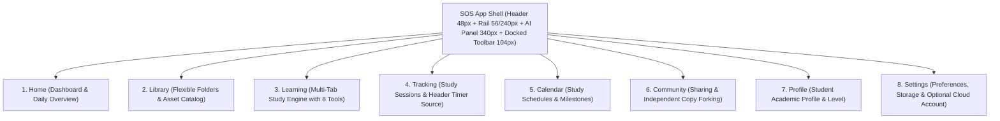
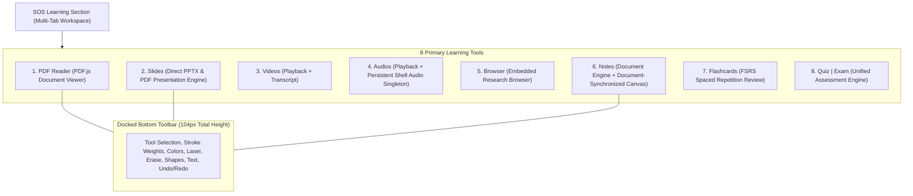

# SOS V3 — Product Specification & Canonical Product Baseline

**Status:** Canonical Product Baseline (Ready for Founder Approval)  
**Version:** 1.0 — November 2026  
**Documentation Baseline:** Post-Audit Canonical Baseline  
**Supersedes & Consolidates:** `PROJECT_CONTEXT.md`, `PRODUCT_STRUCTURE.md`, `PRODUCT_DECISIONS.md`, `PRODUCT_DECISION_REVIEW.md`, `SCREEN_INVENTORY.md`, `SOS_V2_KNOWLEDGE_TRANSFER.md`, `OPEN_QUESTIONS.md`.

---

## 1. Product Identity, Vision & Purpose

### 1.1 What is SOS?
**SOS (Studying Operating System)** is an integrated digital learning environment designed to bring together all tools, academic resources, spatial environments, and intelligent assistance needed to learn effectively.

SOS is **not** another conventional Learning Management System (LMS), basic note-taking app, simple PDF reader, or generic AI chatbot wrapper. It is a unified operating system for learning where students can:
- Ingest and organize academic materials (PDF textbooks, native Microsoft PowerPoint `.pptx` presentations, PDF lecture slide decks, video streams, audio recordings, and research articles).
- Engage in active, spatial study via a unified Notes engine combining structured document blocks with a document-synchronized vector ink canvas.
- Present and review lecture slides directly from native PowerPoint (`.pptx`) files or PDF decks within a dedicated Slides environment without manual conversion.
- Browse the real web interactively for academic research without leaving the application context.
- Test retention using integrated active recall engines (spaced-repetition flashcards and a unified Quiz | Exam assessment engine).
- Receive real-time, context-aware AI assistance through a persistent assistant panel that understands the student's exact learning state.

### 1.2 Core Product Principles
1. **Zero-Friction Access (Guest-First):** The application is 100% usable immediately upon launch. No mandatory registration, authentication wall, or forced cloud onboarding blocks learning.
2. **Deep Focus & Context Preservation:** Eliminates application-switching friction. All primary study modes exist as interconnected tools within a single multi-tab workspace.
3. **Direct Slide Ingestion (No Manual Conversion):** Students can upload native PowerPoint (`.pptx`) decks and PDF slides directly into Slides. SOS does not force users to manually convert files to PDF. The original uploaded file is strictly preserved without destructive modification as an SOS architectural responsibility.
4. **Unified & Document-Synchronized Notes:** The spatial canvas is not an isolated whiteboard or screen-fixed overlay; it is document-synchronized and follows the document's coordinate environment and movement.
5. **Local Data Ownership (Local-First):** Core learning content remains locally persisted by default. The existence of a backend does not mean user data is automatically transmitted or cloud-stored without explicit intent.
6. **Active Retention Over Passive Consumption:** Ingested content can be directly converted into flashcards, practice questions, or spatial margin summaries.

---

## 2. Product Structure & Module Inventory

SOS is structured around the global **App Shell** foundation hosting **eight primary navigation destinations** accessible via the Left Navigation Rail (56px collapsed / 240px expanded) and Top Global Header (48px).

### Module Scope & Baseline Status

| Section | Left Nav Item | Core Purpose & Scope | Baseline Status | Initial Release Scope |
| :--- | :--- | :--- | :--- | :--- |
| **0. App Shell** | Global Shell | Persistent outer frame: 48px top header (with static mirror timer), 56px/240px collapsible navigation rail, global search, breadcrumbs, 104px docked toolbar zone, and 340px collapsible AI assistant drawer. | **Verified Design** | Fully implemented in Phase 01. |
| **1. Home** | Home (`/`) | Personal study command center: greeting, daily streak, quick-resume carousel, upcoming deadlines, daily goal progress, and recent activity feed. | **Verified Design** | Implemented with local reactive data in Phase 02. |
| **2. Library** | Library (`/library`) | Central academic asset repository based on user-defined flexible folders: Gallery, List, and Table views, customizable metadata, structured Pages, binary file ingestion, and early `.sos` backup/restore. | **Core System** | Implemented with local storage hierarchy & backup in Phase 03. |
| **3. Learning** | Learning (`/learning`) | The core operational workspace: multi-tab environment running the eight primary learning tools, document-synchronized canvas, 104px docked toolbar, and shell-level audio singleton. | **Core System** | Implemented across subphases 4.1–4.8 in Phase 04. |
| **4. Tracking** | Tracking (`/tracking`) | Authoritative study-session tracking: Pomodoro focus sessions, elapsed time calculated from timestamps, daily study heatmaps, time-per-subject analytics, and card retention curves. | **Core System** | Implemented with local analytics logging in Phase 05. |
| **5. Calendar** | Calendar (`/calendar`) | Study timeline: exam countdowns, scheduled review sessions, assignment due dates, and study block time-boxing. | **Verified Design** | Implemented with local calendar engine in Phase 06. |
| **6. Community** | Community (`/community`) | Collaborative discovery: shared flashcard decks and study notes. Forking creates an independent copy in the user's Library preserving provenance and attribution. | **Verified Design** | Implemented with discovery catalog & independent copy forking in Phase 07. |
| **7. Profile** | Profile (`/profile`) | Student academic identity: university/major, academic level, earned badges, study statistics summary, avatar customization, and optional accounts. | **Verified Design** | Implemented with local profile store & non-destructive migration in Phase 08. |
| **8. Settings** | Settings (`/settings`) | Application configuration: theme adjustments, local data storage inspector, AI model & quota configuration, and optional cloud sync settings. | **Verified Design** | Implemented with local settings & AI configuration in Phase 09. |

---

## 3. The Learning Section: Eight Primary Tools & Workspace Toolbar (DEC-001)

In accordance with approved decision **DEC-001**, the Learning section contains **exactly eight primary tools**. 

The canvas-enabled tools (Notes, PDF Reader, and Slides) share an anchored **Docked Full-Width Bottom Toolbar (104px)** positioned within the workspace layout, completely independent of canvas pan and zoom transformations.

### 3.1 Tool 1: PDF Reader
- **Capabilities:** Dedicated document reader for academic textbooks, research papers, and lecture handouts via PDF.js.
- **Features:** Multi-page continuous and paged viewing, zoom controls, text selection, search, document positioning, and persisted reading progress.
- **Spatial Integration:** Left/right spatial margins support free-positioned sticky notes and highlight annotations. Text selection enables instant flashcard creation or AI explanation.
- **Separation of Concerns:** PDF Reader is strictly responsible for vertical/continuous academic reading and document annotation. It is kept distinct from the presentation-oriented Slides tool.

### 3.2 Tool 2: Slides (Direct PPTX & PDF Presentation Viewer)
- **Core Product Requirement:** When a student opens a lecture presentation, SOS must accept both PDF presentation files and native PowerPoint `.pptx` files directly. Students are **not** required to convert `.pptx` files to PDF manually.
- **Required User Experience:**
  1. The student opens or uploads a PDF or `.pptx` presentation.
  2. SOS recognizes the format and opens it in the unified Slides environment.
  3. The student navigates slides using stepping controls (Previous/Next), arrow keys, or a visual thumbnail strip.
  4. Fullscreen viewing provides a distraction-free presentation review mode.
  5. Slide-specific spatial annotations (pen, highlighter, laser, sticky notes) are saved per slide (`page_number`).
  6. Reading/presentation position is automatically persisted and restored.
  7. The original uploaded file (`.pptx` or `.pdf`) is strictly preserved without destructive modification as an SOS architectural responsibility.
- **Dual Rendering Engine Architecture:**
  - PDF decks in Slides are rendered using the proven client-side **PDF.js** engine.
  - Native PowerPoint `.pptx` files are rendered using a dedicated PowerPoint viewing solution evaluated from leading candidates:
    - **Nutrient Web SDK (formerly PSPDFKit):** Leading candidate (`RECOMMENDED_PENDING_VALIDATION`), requiring the Office Files licensing component for client-side WASM parsing.
    - **Apryse WebViewer (formerly PDFTron):** Evaluated candidate requiring the Office Conversion add-on for WebViewer.
    - **Syncfusion:** Evaluated candidate offering a JavaScript PowerPoint Library capable of client-side loading, editing, and saving of `.pptx` in browser and Electron environments.
    - **Transparent Internal Conversion:** Viable fallback generating high-fidelity cached slide representations while strictly preserving original `.pptx` files.
  - Both pathways share the same product-level Slides shell (navigation, thumbnails, fullscreen, toolbar, annotations).
- **PowerPoint Feature Boundaries:**
  - Core slide rendering, typography, shapes, tables, charts, images, and slide navigation are required.
  - Full PowerPoint editing and complex animations/transitions are distinguished from core slide viewing and are evaluated according to approved scope.

### 3.3 Tool 3: Videos
- **Capabilities:** Academic video player supporting local video files and external sources (e.g., direct MP4, YouTube via IFrame Player API).
- **Features:** Playback speed control (0.5x to 2.5x), synchronized transcript side-panel with timestamp jumping, timestamped bookmarking, fullscreen, and automatic pause upon tab switch.

### 3.4 Tool 4: Audios
- **Capabilities:** Dedicated lecture audio and podcast player with synchronized waveform and transcript display.
- **Shell-Level Audio Singleton:** When the student switches between different SOS Learning tools or tabs, audio playback **continues in the background**. A compact mini-player in the 48px top header allows control while studying in Notes or Slides.

### 3.5 Tool 5: Browser
- **Capabilities:** Web research browser integrated directly into the workspace for academic lookups.
- **Platform Scope:**
  - **Desktop Target (Electron):** Real, fully functional embedded Chromium browser via `WebContentsView` with session isolation, persistent cookie handling, navigation restrictions, download routing, and security boundaries.
  - **Web Target:** Embedded iframe for compatible sites; clean external opening (`target="_blank"`) for sites blocking framing via CSP / `X-Frame-Options`, paired with an article reader extractor.

### 3.6 Tool 6: Notes (Unified Document Layer + Document-Synchronized Canvas)
- **Capabilities (DEC-002 & DEC-003):** Unified note-taking experience combining:
  1. *Document Layer:* Notion-style structured rich-text blocks (headings, lists, code, tables) powered by Tiptap/ProseMirror.
  2. *Spatial Canvas Layer:* React-Konva vector drawing layer for freehand stylus ink, highlighters, arrows, and diagrams.
- **Document Synchronization:** The Canvas is **document-synchronized**; it follows the document's coordinate environment and movement. When the student scrolls or pans through the document, the Canvas moves in lockstep with the document.
- **Coordinate & Reflow Policy:**
  - Canvas marks are stored in zoom-invariant document coordinates ($$\text{DocX}, \text{DocY}$$), not screen/viewport pixels.
  - Document-relative coordinates anchor to the top-left origin of the document scroll container.
  - No mandatory fixed-width document column is imposed; responsive wide-margin layout provides dedicated canvas space alongside text blocks.
  - Spatial marks remain anchored to their document coordinates; semantic block anchoring (automatically shifting strokes when text paragraphs are inserted above) is an advanced feature explicitly deferred post-v1.

### 3.7 Tool 7: Flashcards
- **Capabilities:** Active recall flashcard review engine utilizing modern spaced repetition scheduling.
- **Scheduling Algorithm:** **FSRS (Free Spaced Repetition Scheduler)** via `ts-fsrs` is the preferred algorithm, delivering superior retention efficiency over legacy SM-2. Initial implementation uses recommended FSRS model defaults with versioned history, deferring custom parameter calibration until significant individual review volume is accumulated.
- **Features:** Dual-sided cards with rich markdown, KaTeX math notation, rating buttons (Again, Hard, Good, Easy), deck mastery tracking, and separated review history logs.

### 3.8 Tool 8: Quiz | Exam (Unified Assessment Engine)
- **Exact Name & Structure:** **Quiz | Exam** is **one unified tool**, not two separate applications, distinct workflows, or disconnected modes. There is no separate Quiz mode and Exam mode, and no special behavior or settings based on the names Quiz or Exam.
- **Capabilities:** Comprehensive assessment engine supporting multiple choice, multi-select, true/false, fill-in-the-blank, and open-response questions.
- **Assessment Configuration:** An individual Assessment may have its own configuration (such as an optional time limit, question shuffling/ordering, or feedback timing), but this configuration applies directly to the individual Assessment itself, with no distinction between a "quiz" and an "exam".

---

## 4. Workspace Interaction: Docked Full-Width Bottom Toolbar

In accordance with the design specification in [DESIGN.md](file:///d:/THE%20DECAGON/OTHER/SOS%20v3/DESIGN.md), the primary annotation toolbar is **fixed and docked** at the base of the central workspace:

### 4.1 Behavioral Principles
1. **Docked Geometry:** Approximately `104px` total height, spanning `100%` width of the central workspace container (`#09090B` surface, `1px` top border `#1F1F23`).
2. **Layout Space Reservation:** The document/presentation content area sits directly above it with `flex: 1`, reserving the 104px vertical height so that the toolbar **never covers** document text or presentation slides.
3. **Canvas Invariance:** The toolbar is an anchored application interface element, **not a canvas object**. It does not move during canvas panning and does not scale during zoom operations.
4. **Synchronous Responsiveness:** When the Left Navigation Rail expands (56px to 240px) or the Right AI Assistant Drawer opens (340px) or closes, the central workspace resizes horizontally, and the docked toolbar resizes synchronously.

---

## 5. Library: Flexible Folders & Multi-View Architecture

Library is the central system for organizing academic materials:
1. **Folders as Primary Model:** Users organize material through flexible, user-defined folder structures. SOS does **not** enforce a rigid `Subject → Course → Module` hierarchy, though students may adopt that convention voluntarily.
2. **Multiple Views:** Supports **Gallery**, **List**, and **Table** views with customizable item size, name, icon, cover, and preview displays.
3. **Structured Pages:** Supports block-based Library Pages sharing the structured document editor technology with Notes, while maintaining distinct domain ownership and metadata.

---

## 6. Tracking & Header Timer Relationship

1. **Single Source of Truth:** Tracking owns the authoritative study session, duration, pause/resume events, and focus metrics.
2. **Static Display-Only Mirror:** The **Header Timer** is a static, display-only visual mirror of the Tracking session. It is not an independent clock, does not drift, and derives its elapsed time from persisted timestamps.

---

## 7. Community & Independent Copy Forking

1. **Independent Copy Operation:** Forking creates an independent copy of a shared resource inside the user's personal Library.
2. **Attribution & Provenance:** The fork preserves the original author's attribution snapshot and source version ID, but subsequent edits by either party remain completely independent.

---

## 8. Approved Product Decisions (Authoritative Register)

| ID | Title | Summary & Authoritative Requirement |
| :--- | :--- | :--- |
| **DEC-001** | Eight Learning Tools | SOS Learning contains exactly 8 primary tools: PDF Reader, Slides, Videos, Audios, Browser, Notes, Flashcards, Quiz \| Exam. Canvas is integrated into Notes, PDF, and Slides. Quiz \| Exam is one unified assessment tool without distinct sub-modes. |
| **DEC-002** | Unified Notes Experience | Notes is a single unified experience combining a Document Layer with a Document-Synchronized Spatial Canvas. |
| **DEC-003** | Document-Synchronized Coordinates | Canvas annotations follow document movement and scrolling. No mandatory fixed-width document constraint is imposed. |
| **DEC-004** | Direct PPTX & PDF Slides Ingestion | Slides directly accepts both native PowerPoint (`.pptx`) decks and PDF presentations. Users are never required to manually convert PPTX to PDF. Shared Slides shell with dual rendering adapters; original presentation files preserved. |
| **DEC-005** | Real Embedded Browser | Desktop uses Electron `WebContentsView` for embedded browsing with session isolation; Web uses external tab launcher paired with article reading mode. |
| **DEC-006** | Tiered Tab State Preservation | Three-tier lifecycle: Active (1 in DOM), Warm (in RAM cache), Cold (on disk) to prevent memory exhaustion while keeping <50ms switch speeds. |
| **DEC-007** | Strict Obsidian Design Palette | Dark, minimal, obsidian-inspired grayscale palette (`#000000`, `#09090B`, `#0C0C0E`, `#141417`, `#222226`, `#2A2A30`), 48px header, 56px/240px rail, 340px AI panel, 104px docked toolbar. |
| **DEC-008** | Context-Aware AI Panel | Persistent ~340px right drawer. Google Gemini API as initial candidate. Server-side credentials. User-approved context selection. No silent paid fallback. BYOK is not mandatory. |
| **DEC-009** | Guest-First & Local-First Access | Full functionality immediately in Guest Mode without mandatory sign-in. Local storage (Dexie/IndexedDB + OPFS/filesystem) by default. Cloud accounts strictly optional. |
| **DEC-010** | Hybrid Web + Desktop Strategy | Web is universal core product; Desktop provides enhanced local filesystem access and embedded Chromium browser. |
| **DEC-011** | Docked Workspace Toolbar | Canvas annotation toolbar is fixed and docked at workspace footer (104px height), reserves layout space, and is invariant to canvas pan/zoom. |
| **DEC-012** | Backend Begins in Phase 01 | Node.js + Fastify 5 + PostgreSQL 18.7 + Drizzle backend starts in Phase 01 alongside frontend foundations. |
| **DEC-013** | Library Flexible Folders | User-defined flexible folder hierarchy with Gallery, List, and Table views; no forced rigid taxonomy. |
| **DEC-014** | Authoritative Tracking & Mirror Timer | Tracking owns the session; Header Timer is a static display mirror deriving time from timestamps. |
| **DEC-015** | Community Independent Copy Forking | Forking copies the resource into the user's Library with attribution snapshot and independent ownership. |

---

## 9. Product Scope & Initial Release Boundaries

### In Scope for Initial Release (v1.0)
- Full App Shell with 48px Header, 56px/240px Navigation Rail, 340px AI Panel, and 104px Docked Toolbar.
- Home dashboard with local stats, daily goals, and quick-resume shortcuts.
- Library with flexible user-defined folders, multi-view catalog (Gallery/List/Table), and structured Pages.
- Multi-Tab Learning Workspace supporting all 8 tools with Active/Warm/Cold lifecycle.
- Notes with Tiptap structured document editing and Konva document-synchronized vector ink canvas.
- Slides with direct `.pptx` and PDF upload, shared presentation shell (thumbnails, fullscreen, slide annotations), and strict preservation of original files.
- Dedicated PDF Reader powered by PDF.js with margin annotations and reading progress.
- Video and Audio players with transcript display and persistent shell-level Audio Singleton.
- Desktop Electron shell with embedded Chromium browser (`WebContentsView`) and session isolation.
- Spaced repetition flashcards powered by FSRS (`ts-fsrs`) using recommended defaults and unified Quiz | Exam assessment engine.
- Persistent AI assistant panel integrated with Google Gemini via server-side Fastify API with dynamic model selection.
- Full local persistence via Dexie/IndexedDB and local filesystem with zero sign-in required.
- Local `.sos` / ZIP export and restore for data durability.

### Deferred to Post-v1.0 Releases
- Advanced PowerPoint editing and complex animation authoring.
- Multi-device real-time cloud synchronization and collaborative peer-to-peer editing.
- Community public marketplace and live social deck exchange.
- Automated AI video auto-transcription via Whisper (v1 supports WebVTT/SRT transcript ingestion).
- Mandatory cloud accounts or mandatory BYOK.
- Custom FSRS parameter calibration (deferred until sufficient individual review volume is accumulated).
