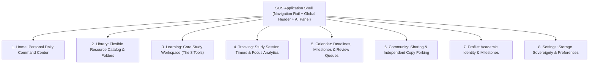
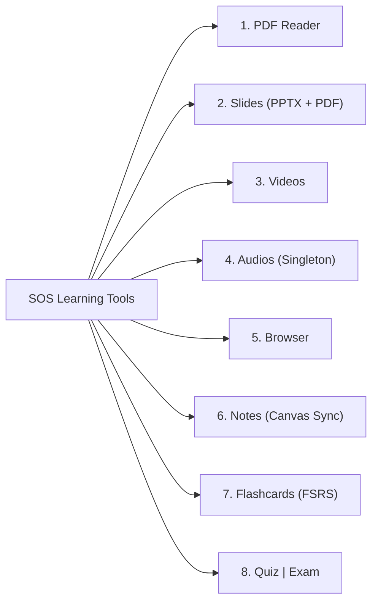

# SOS — Studying Operating System
# Nontechnical Decision Reference & Product Architecture Guide

**Document Identifier:** `SOS_DECISIONS_NONTECHNICAL.md`  
**Version:** 1.0 — November 2026  
**Audience:** Founder, Product Designers, Nontechnical Collaborators, Future Team Members, and Stakeholders  
**Scope:** Canonical nontechnical reference explaining what SOS is, how each feature works, why every major choice was made, and what principles guide the product.

---

## 1. Introduction & Product Philosophy

### 1.1 What is SOS?
**SOS (Studying Operating System)** is an integrated digital environment built for anyone who wants to study and master complex material. 

Most students today are forced to stitch together a fragmented collection of separate apps:
- A PDF viewer for textbooks.
- A presentation app for lecture slides.
- A note-taking tool for typed summaries.
- A drawing app for handwritten diagrams.
- A flashcard app for memorization.
- A browser for academic lookups.
- A video player for recorded lectures.
- A timer for Pomodoro focus sessions.
- An AI chatbot in another browser tab.

Switching constantly between these disconnected tools creates **context fragmentation**: attention is broken, files are scattered, notes lose their connection to lecture slides, and flashcards must be manually copied from textbooks.

SOS eliminates this friction by bringing all of these capabilities into **one coherent, deeply integrated learning operating system**.

### 1.2 Core Product Principles
- **Learning Effectiveness Over Feature Clutter:** SOS is not a generic productivity dashboard or bloated all-in-one workspace. Every capability is designed specifically to help learners ingest, understand, retain, and recall knowledge.
- **Zero-Friction Access (Guest-First):** Learning should never be blocked by a login screen. Anyone can open SOS and start studying immediately as a Guest. Creating an account is strictly optional.
- **Local Data Ownership (Local-First):** Your study notes, textbooks, and flashcards belong to you. They are saved on your own device first. Even though SOS has a backend server for AI and services, your private study data is not secretly uploaded to the cloud.
- **Deep Integration:** The value of SOS lies in how its parts talk to each other: clicking a paragraph in a textbook can create a flashcard; an audio lecture continues playing while you take notes on slides; and the AI assistant knows exactly which slide you are looking at.
- **Design Restraint (Obsidian Theme):** The interface is dark, quiet, and beautiful. Saturated colors and distracting animations are eliminated so the learner's focus stays entirely on their study material. (Design tokens and specifications reviewed from canonical documentation).

---

## 2. Complete Product Structure (The Eight Areas)

The application is structured into eight primary areas, accessible via a quiet navigation rail on the left and a clean header at the top:

1. **Home:** Your daily launchpad. Shows your study streak, daily goal progress (minutes studied), a "Quick Resume" carousel of the exact files you were studying yesterday, and upcoming deadlines.
2. **Library:** Your master academic shelf. Ingests and organizes textbooks, lecture presentations, research papers, video lectures, and structured study pages using flexible, user-defined folders.
3. **Learning:** The functional heart of SOS. A multi-tab study workspace hosting the eight specialized learning tools.
4. **Tracking:** Owns your actual study sessions, Pomodoro timers, focus intervals, and learning heatmaps.
5. **Calendar:** Helps you schedule study blocks, tracks upcoming exams, and calculates when flashcards are due for review.
6. **Community:** A place to discover shared flashcard decks and study notes created by other students, allowing you to create independent copies ("forks") into your own library.
7. **Profile:** Your academic profile, major, university, and earned study milestone badges.
8. **Settings:** Controls application theme contrast, local data backup/export, storage usage, AI model selection, and optional cloud account linking.

---

## 3. The Eight Learning Tools

Learning provides direct access to eight purpose-built tools:

### 3.1 Tool 1: PDF Reader
Designed specifically for deep reading of academic textbooks, research papers, and syllabi. Powered by PDF.js, it supports continuous vertical scrolling, two-page book views, high-resolution rendering, text selection, keyword search, and spatial margin annotations for sticky notes and highlights.

### 3.2 Tool 2: Slides (Direct PPTX & PDF Presentation Engine)
- **Direct PowerPoint Ingestion:** When a professor gives you a native PowerPoint (`.pptx`) file, you can upload it directly into Slides. **You are never forced to convert PowerPoint files to PDF manually.**
- **PDF Presentations Supported:** Slides also accepts presentations saved as PDF files.
- **Shared Presentation Experience:** Both `.pptx` and `.pdf` files open in the same dedicated Slides interface: 16:9 widescreen layout, slide-by-slide stepping, a visual thumbnail strip at the bottom, fullscreen review, and slide-specific handwriting annotations.
- **Original File Preservation:** Preserving your original presentation file without modification is an SOS architectural duty.
- **Realistic Boundaries:** Core slide layouts, shapes, tables, charts, images, and text render cleanly. Advanced PowerPoint authoring (creating complex animations or editing slide masters) is distinguished from presentation study and is not required for learning review.

### 3.3 Tool 3: Videos
An academic video player for recorded lectures and educational videos (local MP4 files or streaming links like YouTube). Features synchronized transcripts where clicking any word jumps the video to that exact second, variable playback speed (0.5x to 2.5x), and timestamped bookmarks.

### 3.4 Tool 4: Audios (Persistent Audio Singleton)
Dedicated player for audio lectures and podcasts. **Audio never stops when you switch tabs.** You can start an audio lecture, switch to Notes to type, open Slides to review a diagram, and the audio continues playing smoothly in the background, controlled from a mini-player in the top header.

### 3.5 Tool 5: Browser
An in-app research browser. On the Desktop app, it runs a native embedded browser with session isolation, persistent cookie handling, navigation restrictions, and download routing. On the Web app, it embeds framing-compatible pages and opens blocked sites cleanly in external tabs while extracting clean article text.

### 3.6 Tool 6: Notes (Document Layer + Document-Synchronized Canvas)
A unified note-taking environment combining structured typed text with handwritten drawing:
- **Document Layer:** Notion-style structured writing with headings, lists, tables, callout boxes, and code blocks.
- **Document-Synchronized Spatial Canvas:** A drawing layer for freehand stylus ink, highlighters, arrows, and visual diagrams.
- **Synchronized Movement:** The canvas moves with the document. When you scroll through your notes, your handwriting moves in lockstep with the text. Drawings do not get left behind or stay frozen on the screen.
- **No Artificial Constraints:** The document is not artificially locked to a narrow column width; it adapts naturally to your screen.

### 3.7 Tool 7: Flashcards (FSRS Spaced Repetition)
An active recall practice tool. Uses **FSRS (Free Spaced Repetition Scheduler)**, a modern learning algorithm proven to be significantly more efficient than legacy 1980s algorithms like SuperMemo (SM-2). It predicts when your memory of a concept is about to fade and schedules a review at the exact optimal moment using recommended defaults and versioned history.

### 3.8 Tool 8: Quiz | Exam (One Unified Tool)
**Quiz | Exam is one single assessment tool.** It is not two separate systems, distinct workflows, or disconnected modes. There is no separate Quiz mode and Exam mode, and no special behavior or settings based merely on the names Quiz or Exam. 

An individual Assessment may have its own configuration (such as an optional time limit, question shuffling/ordering, or feedback timing), but this configuration applies directly to the individual Assessment itself, with no distinction between a "quiz" and an "exam".

---

## 4. Library: Flexible Folders & Multi-View Organization

The Library is your academic filing system:
- **Folders are the Foundation:** You can create any folder structure that fits your life (e.g. `Year 3 > Cardiology > Lecture Notes`, or `Certifications > AWS > Flashcards`). SOS does **not** force a rigid `Subject > Course > Module` hierarchy on you.
- **Multiple Views:** Browse your materials in **Gallery view** (rich visual cards with covers), **List view** (compact and fast), or **Table view** (structured columns showing dates, file sizes, and progress).
- **Structured Pages:** You can create standalone notes and document pages directly inside the Library without having to open the multi-tab workspace first.

---

## 5. Notes & Canvas: How Document Synchronization Works

A common problem in note-taking apps is that handwritten annotations either exist on an isolated infinite whiteboard disconnected from typed text, or they sit on a transparent layer that stays stuck to the screen when you scroll.

SOS solves this with **Document Synchronization**:
- The typed document and the drawing canvas share the same coordinate environment.
- The top-left corner of your document is the anchor ($$0, 0$$).
- When you draw an arrow pointing to a paragraph, that arrow is recorded at its exact document position.
- As you scroll down the page, the canvas translates with the document. Your drawings stay aligned with their text.
- If you zoom in, both the text and your drawings zoom together smoothly.

---

## 6. PDF and PowerPoint Presentation Handling

### Why PDF.js Cannot Open PowerPoint Directly
PDF.js is an open-source rendering engine built specifically for the PDF document standard. A Microsoft PowerPoint file (`.pptx`) is completely different: it is an XML-based zip archive containing shapes, slide masters, typography rules, and vector layouts. PDF.js cannot read or render `.pptx` files.

### How SOS Solves the Slides Problem
To deliver a zero-friction student experience:
1. When you open a PDF presentation, SOS uses PDF.js to render the slides.
2. When you open a PowerPoint (`.pptx`) presentation, SOS uses an evaluated, dedicated presentation viewing solution:
   - **Nutrient Web SDK:** Leading candidate (`RECOMMENDED_PENDING_VALIDATION`), requiring the Office Files licensing component for client-side WASM parsing.
   - **Apryse WebViewer:** Evaluated candidate requiring the Office Conversion add-on for WebViewer.
   - **Syncfusion:** Evaluated candidate offering a JavaScript PowerPoint Library capable of client-side loading, editing, and saving of `.pptx` in browser and Electron environments.
   - **Transparent Internal Conversion:** Viable fallback generating high-fidelity cached slide representations.
3. Both formats present the **exact same user experience**: slide numbers, previous/next buttons, visual thumbnail strip, fullscreen presentation mode, and slide handwriting tools.
4. Preserving your original presentation file without modification is an SOS architectural duty.

---

## 7. Media & Browser Experience

- **Why Persistent Audio Matters:** Medical and law students frequently listen to 2-hour audio lectures while summarizing slides or typing notes. If switching from an Audio tab to a Notes tab stopped playback, the app would be unusable. SOS maintains a single background audio engine that stays active regardless of which tab is focused.
- **Videos with Transcripts:** Video lectures display interactive transcripts. If a professor mentions "mitral valve regurgitation," you can search the transcript and click the phrase to jump straight to that moment in the video.
- **Browser Differences:** On Desktop, SOS embeds a native Chromium browser capable of isolated academic browsing with persistent cookies and security boundaries. On the Web, due to internet security rules (where sites like Google or PubMed block being displayed inside iframes), SOS cleanly launches external tabs and provides clean reader-mode text extraction.

---

## 8. Tracking and the Header Timer

- **One Source of Truth:** Tracking is the sole engine that measures time. When you start a 25-minute Pomodoro study block, Tracking records the exact timestamp (e.g., 09:15:00 AM).
- **The Header Timer is a Static Mirror:** The timer displayed in the top header is a display-only mirror of the Tracking session. It does not run its own independent clock. If you put your laptop to sleep and open it 10 minutes later, the timer computes elapsed time from the real clock—it never drifts or gets out of sync.

---

## 9. Community and Independent Copy Forking

When students share study decks or summary notes in the Community:
- **Forking Means an Independent Copy:** When you "fork" a flashcard deck or set of notes created by another student, SOS creates a completely independent copy inside your own personal Library.
- **Preserved Attribution:** The copy permanently credits the original author and records the exact version you downloaded.
- **Freedom to Edit:** You can freely add cards, reword explanations, or delete sections. Changes made by the original author later will never overwrite or ruin your customized deck.

---

## 10. Guest-First and Local-First: True Data Sovereignty

### Guest-First (No Mandatory Sign-In)
When you launch SOS for the first time, you are not asked for an email, password, credit card, or social login. You simply click **Continue as Guest**, and your workspace is ready immediately.

### Local-First (Your Data Lives on Your Device)
- All your notes, folders, highlights, flashcards, and uploaded files are saved in your computer's local database (Dexie / IndexedDB and your local filesystem).
- You can study on an airplane or without Wi-Fi; all core learning tools work completely offline.
- Having a backend server does **not** mean your private files are uploaded. The backend exists to handle AI requests, manage service identity, and support optional features.

### Backup and Restoration (`.sos` Archives)
Because your data is stored locally, data durability is essential. SOS includes full **Workspace Backup and Restore**:
- With one click, you can export your entire study workspace as an encrypted, compressed `.sos` archive file.
- If you switch computers or clear your browser, you can import that file and restore every folder, note, card, and drawing with 100% fidelity.

---

## 11. The AI Assistant: Helpful, Transparent & Contained

SOS features an integrated AI study copilot housed in a persistent 340px right-hand drawer:
- **Context-Aware:** You can highlight a confusing paragraph in a PDF textbook and ask `/explain`, or click a slide and ask "Generate 3 flashcards testing this diagram."
- **User Consent & Privacy:** SOS **never** uploads your entire library or private notes to the AI behind your back. The AI only receives the specific text or slide excerpt you explicitly choose to share.
- **Dynamic Model Selection:** The UI queries available models dynamically from the backend Model Registry (with generic placeholder "Select Model" / "Available Models").
- **Server-Side Security:** Your AI keys and credentials remain safely on the backend server; they are never exposed inside your web browser.
- **No Silent Paid Traps:** If your free daily AI quota is exhausted, SOS explains the situation clearly. It never secretly charges your card or switches you to a paid plan without explicit confirmation.
- **BYOK (Bring Your Own Key) is Optional:** Ordinary students are not expected to understand API keys or create developer accounts.

---

## 12. Technology Choices Explained in Plain Language

| Technology | What it Does in Plain English | Why it Was Chosen for SOS | Alternatives Considered | Why the Alternative Was Not Chosen |
| :--- | :--- | :--- | :--- | :--- |
| **React 19** | The UI component engine that renders buttons, tabs, and cards. | Industry standard, massive ecosystem, fast rendering, universal developer knowledge. | Vue, Svelte | Smaller ecosystems, less mature tooling for complex canvas and rich-text integrations. |
| **TypeScript** | Adds strict type checking to JavaScript to catch bugs before they reach users. | Eliminates entire classes of runtime errors; ensures contract safety between client and server. | Plain JavaScript | Too fragile for a large application managing complex data models and coordinates. |
| **Vite** | The build tool and development server that packages the web application. | Starts in milliseconds; provides sub-100ms updates when modifying code. | Next.js, Webpack | Next.js adds complex server-side rendering overhead unnecessary for a local-first desktop app. |
| **Electron** | Packages the web app into a native desktop application for Mac, Windows, and Linux. | Allows real embedded Chromium browsing (`WebContentsView`) and direct access to local files. | Tauri | Tauri's webview differences across operating systems break embedded browser and canvas parity. |
| **Fastify** | High-speed Node.js backend server. | Extremely lightweight, low memory footprint, native TypeScript support, built-in schema validation. | FastAPI (Python), Express | Express is outdated; FastAPI would introduce a second language (Python) unnecessarily. |
| **PostgreSQL 18** | Robust relational database running on the server. | Intended major working recommendation for accounts, AI quotas, community sharing, and sync metadata (subject to hosting compatibility and stable patch verification). | MySQL, MongoDB | Postgres has superior JSON handling, ACID reliability, and relational integrity. |
| **Dexie (IndexedDB)**| Database running directly inside your browser or desktop app. | Stores thousands of notes, cards, and annotations locally with instant sub-millisecond queries. | SQLite WASM | Dexie is mature, rock-solid in all browsers, and requires zero complex WASM memory management. |
| **OPFS** | Origin Private File System; high-speed browser file storage. | Allows the Web version to store large 500MB PDF textbooks and videos without crashing browser RAM. | Storing blobs in IndexedDB | IndexedDB crashes or slows down when storing hundreds of massive binary files. |
| **Tiptap (ProseMirror)**| The structured rich-text document editor. | Powers clean block editing (headings, lists, tables) with clean JSON storage; highly extensible. | Lexical, Slate | Slate is unstable; Lexical has a steeper curve; Tiptap has the best extension ecosystem. |
| **Konva (React-Konva)**| The 2D vector graphics drawing engine. | Renders 60fps stylus drawing, highlighters, and shapes on HTML5 Canvas with hardware acceleration. | Fabric.js, tldraw | Fabric.js is older; tldraw has restrictive licensing and forces an infinite whiteboard model. |
| **PDF.js** | Mozilla's battle-tested PDF rendering engine. | Universal standard for opening and viewing PDF files in browsers without third-party plugins. | Commercial PDF SDKs | Commercial engines cost tens of thousands of dollars; PDF.js is free, open, and reliable. |
| **FSRS (`ts-fsrs`)** | Free Spaced Repetition Scheduler algorithm. | Predicts memory forgetting curves with modern precision, reducing review time by ~30%. Starts with recommended defaults. | SuperMemo (SM-2) | SM-2 is a 35-year-old heuristic formula that over-schedules cards and wastes study time. |
| **Vercel AI SDK Core** | Universal library for streaming AI responses and handling tool calls. | Clean TypeScript streaming abstraction that works with any AI provider and any backend host. | Direct Google SDK | Locking directly to one vendor's SDK makes future model switching difficult. |

---

## 13. Future Migration Paths & What Could Change

A sound architecture plans for the future without over-engineering today. Here is what could change and why:
- **Dexie to SQLite:** If students create massive libraries (100,000+ notes) where browser IndexedDB reaches performance limits, SOS can seamlessly migrate its local database to SQLite.
- **Electron to Tauri:** If Tauri's multi-platform webview matures to offer 100% identical embedded browser and canvas performance across Windows, Mac, and Linux, SOS could evaluate it to reduce app download size.
- **AI Provider Switch:** If Google Gemini changes its pricing, terms, or privacy policies unfavorably, the Vercel AI SDK Core abstraction allows SOS to switch to Anthropic Claude or OpenAI in hours by updating backend configuration.
- **Real-Time Collaboration (CRDTs):** If SOS introduces real-time multiplayer document editing between students in a study group, a synchronization layer like Yjs can be introduced on top of the existing Tiptap editor.

---

## 14. Glossary of Nontechnical Terms

- **Local-First:** An architecture where your data is stored on your own physical computer first, allowing the app to work 100% offline.
- **Guest-First:** The philosophy that anyone should be able to open and use the application immediately without creating an account or signing in.
- **Backend:** The server software running in the cloud that handles tasks your computer cannot do alone (like processing AI requests safely).
- **API (Application Programming Interface):** The secure communication bridge between the SOS app on your screen and the backend server.
- **Schema:** The formal structural blueprint that defines how a document, flashcard, or database record is formatted.
- **Spaced Repetition:** A scientifically proven learning technique where cards are reviewed at increasing intervals just as you are about to forget them.
- **Provenance:** The verifiable history of who created a study resource, when it was published, and what changes were made.
- **Fork:** Creating your own personal, independently editable copy of someone else's shared study deck or notes.
- **Active / Warm / Cold Tabs:** A memory-saving strategy where only your current tab uses full computer resources, recent tabs stay ready in memory, and older tabs rest on disk so your laptop never slows down.

---

## 15. Canonical Decision Status Summary

| Decision ID | Area | Decision Summary | Authoritative Status |
| :--- | :--- | :--- | :--- |
| **REQ-001** | Onboarding | Zero mandatory sign-in; instant Guest workspace creation. | `CONFIRMED_PRODUCT_REQUIREMENT` |
| **REQ-002** | Library | User-defined flexible folders; Gallery, List, and Table views; structured Pages. | `CONFIRMED_PRODUCT_REQUIREMENT` |
| **REQ-003** | Notes | Unified document writing + document-synchronized handwriting canvas. | `CONFIRMED_PRODUCT_REQUIREMENT` |
| **REQ-004** | Slides | Direct native PowerPoint (`.pptx`) and PDF slide ingestion. No manual user conversion. Original files preserved. | `CONFIRMED_PRODUCT_REQUIREMENT` |
| **REQ-005** | Assessment | Quiz \| Exam is one single unified assessment tool without distinct sub-modes; configurations apply directly to assessments. | `CONFIRMED_PRODUCT_REQUIREMENT` |
| **REQ-006** | Tracking | Tracking owns the authoritative study session; Header Timer is a static mirror. | `CONFIRMED_PRODUCT_REQUIREMENT` |
| **REQ-007** | Community | Forking creates an independent copy in Library with preserved attribution snapshot. | `CONFIRMED_PRODUCT_REQUIREMENT` |
| **REQ-008** | Audio | Persistent shell audio singleton that continues playing when switching tabs. | `CONFIRMED_PRODUCT_REQUIREMENT` |
| **TECH-001** | Stack | React 19 + TypeScript 5.8 + Vite 8 in pnpm monorepo. | `APPROVED` |
| **TECH-002** | Backend | Node.js LTS + Fastify 5 + PostgreSQL 18 + Drizzle ORM begins in Phase 01. | `APPROVED` |
| **TECH-003** | Desktop | Electron 45 with `WebContentsView` for isolated embedded browsing. | `APPROVED` |
| **TECH-004** | Storage | Dexie (IndexedDB) for local data; OPFS / filesystem for binary files. | `APPROVED` |
| **TECH-005** | Toolbar | 104px Docked Bottom Toolbar anchored to layout, invariant to canvas pan/zoom. | `APPROVED` |
| **TECH-006** | PDF Engine | PDF.js 4.10 for ordinary PDFs and PDF presentation decks. | `APPROVED` |
| **TECH-007** | PPTX Engine | Dedicated presentation viewing SDK (Nutrient Web SDK as leading candidate, Apryse, Syncfusion, or transparent conversion). | `RECOMMENDED_PENDING_VALIDATION` |
| **TECH-008** | Flashcards | FSRS algorithm via `ts-fsrs` using recommended defaults. | `RECOMMENDED` |
| **TECH-009** | AI Gateway | Vercel AI SDK Core + `@ai-sdk/google` (Gemini API); dynamic model selection; server credentials; no AI Gateway. | `RECOMMENDED` |
| **TECH-010** | Cloud Sync | Full cloud synchronization deferred to Phase 10 with non-destructive migration. | `DEFERRED` |
