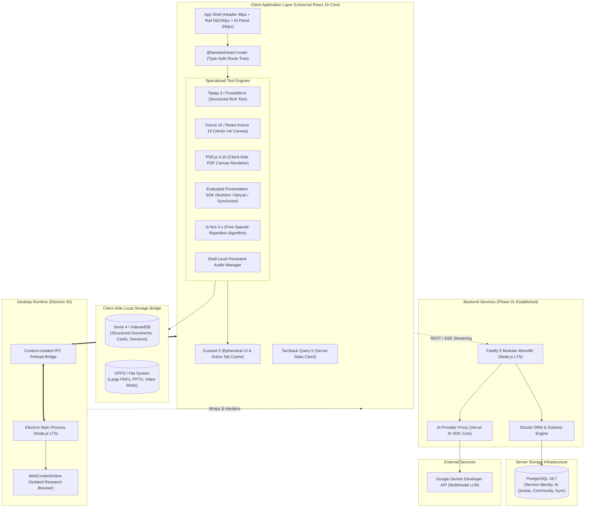
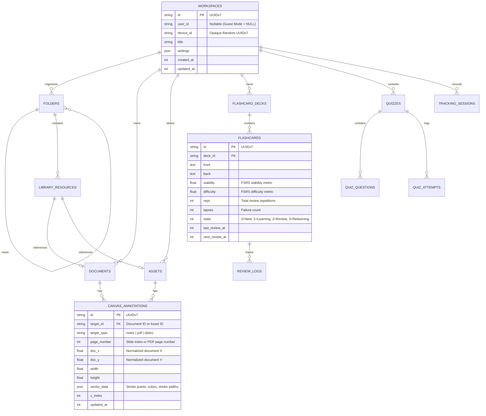

# SOS — Studying Operating System
# Canonical Technical Architecture & Decision Records

**Document Identifier:** `SOS_DECISIONS_TECHNICAL.md`  
**Version:** 1.0 — November 2026  
**Documentation Baseline:** Post-Audit Canonical Baseline (Ready for Founder Approval)  
**Audience:** Principal Software Architects, Full-Stack Engineers, AI Coding Agents, Security Engineers  
**Scope:** Authoritative engineering specification, mathematical standards, technology comparisons, architectural decision records (ADRs), and implementation constraints for SOS V3.

---

## 1. Technical Overview & Core Tenets

SOS V3 is engineered as a **Local-First, Modular Monolith** delivering high-performance study tools across Web (Universal SPA) and Desktop (Electron 45).

### Core Tenets
1. **Local-First as Primary State:** User study data (documents, canvas vector ink, flashcards, library metadata) is persisted locally in client-side storage (Dexie / IndexedDB and OPFS/filesystem).
2. **Backend Established in Phase 01:** A Node.js LTS + Fastify 5 backend is established in Phase 01 alongside frontend foundations. The backend provides service identity, server-side custody of AI provider credentials, quota controls, database migrations, and optional account infrastructure.
3. **No Manually Forced Conversion:** Slides directly accepts native Microsoft PowerPoint (`.pptx`) decks and PDF presentations. A shared Slides shell delegates to specialized rendering adapters (PDF.js for PDF; an evaluated presentation SDK for `.pptx`). Preserving original files without destructive modification is an SOS architectural duty.
4. **Document-Synchronized Canvas:** In Notes, the spatial canvas is synchronized with document coordinate movement and scrolling in lockstep. Annotations are stored in zoom-invariant document coordinates, never screen pixels. No artificial fixed-width document constraint is imposed.
5. **Obsidian Surface Hierarchy:** Strict visual adherence to the verified design specifications in [DESIGN.md](file:///d:/THE%20DECAGON/OTHER/SOS%20v3/DESIGN.md): 48px header, 56px/240px rail, 340px AI panel, and 104px docked toolbar (reviewed from canonical design tokens and specifications).

---

## 2. System Architecture & Component Topology



---

## 3. Repository Architecture (pnpm Monorepo)

SOS uses a clean **pnpm monorepo** with strictly enforced dependency boundaries:

```text
sos-v3/
├── apps/
│   ├── web/                # Universal React 19 SPA (Vite 8)
│   ├── desktop/            # Electron 45 main and preload wrapper
│   └── api/                # Fastify 5 modular monolith backend
├── packages/
│   ├── domain/             # Pure TypeScript domain models, UUIDv7, FSRS math
│   ├── contracts/          # Zod schemas & OpenAPI endpoint contracts
│   ├── ui/                 # Shared Tailwind v4 React components & tokens
│   ├── editor/             # Tiptap ProseMirror extensions & schemas
│   ├── canvas/             # Konva stage, vector tools & coordinate math
│   └── persistence/        # Dexie schema, migrations & OPFS adapters
├── package.json            # Root workspaces declaration
├── pnpm-workspace.yaml     # Monorepo definitions
└── tsconfig.base.json      # Shared strict TypeScript configuration
```

### Dependency Rules:
- `packages/domain` has **zero external runtime dependencies** (pure logic).
- `packages/contracts` depends solely on `zod` and imports types from `packages/domain`.
- `apps/web` and `apps/desktop` import from `packages/*`.
- `apps/api` imports from `packages/contracts` and `packages/domain`. It never imports client UI libraries.

---

## 4. Frontend Architecture (React 19 + TypeScript + Vite 8)

1. **Client Rendering Model:** Client-Side Single Page Application (SPA). Zero Server-Side Rendering (SSR) hydration mismatch.
2. **Type-Safe Routing:** `@tanstack/react-router` generates route trees with validated URL parameters:
   - `/` (Home)
   - `/library` (Asset Catalog)
   - `/learning` (Multi-Tab Workspace with search params: `?tab=uuid&tool=slides`)
   - `/tracking` (Focus analytics)
   - `/calendar` (Academic schedule)
   - `/community` (Shared resource discovery)
   - `/profile` (User academic milestones)
   - `/settings` (Preferences, export/restore, AI configuration)
3. **Styling Engine:** Tailwind CSS v4 using modern `@theme` CSS-first variables directly referencing the obsidian design tokens defined in `DESIGN.md`.

---

## 5. Desktop Architecture (Electron 45 Shell)

### 5.1 Electron vs. Tauri Analysis

| Dimension | Electron 45 (Selected) | Tauri 2.0 (Evaluated Alternative) | Technical Rationale |
| :--- | :--- | :--- | :--- |
| **Browser Engine Parity** | 100% Guaranteed (Bundled Chromium 134). | Variable (WebView2 on Windows, WebKit on Mac, WebKitGTK on Linux). | Critical: Embedded research browser requires identical session isolation, cookie handling, and canvas rendering across OS targets. |
| **Embedded Browsing Tool** | Native `WebContentsView` allows full multi-tab arbitrary HTTPS sites with cookie partitions. | Lacks multi-instance isolated WebContentsView equivalent without complex native window hacks. | The SOS Browser tool is an essential research capability; Electron provides complete native window child support. |
| **Installer Size** | ~75MB–90MB compressed. | ~15MB–25MB compressed. | Acceptable trade-off: reliable canvas performance, full WebAssembly memory budget, and identical Chromium devtools outweigh binary size. |
| **Filesystem Streaming** | Node.js native `fs` streams large 1GB video/PDF files effortlessly. | Requires custom Rust IPC streaming serialization. | Node.js streams directly into local memory buffers with zero serialization penalty. |

### 5.2 Desktop Hardening Specifications
```typescript
// apps/desktop/src/main.ts - Hardened Window Initialization
const mainWindow = new BrowserWindow({
  width: 1440,
  height: 900,
  backgroundColor: '#000000',
  webPreferences: {
    nodeIntegration: false,
    contextIsolation: true,
    sandbox: true,
    preload: path.join(__dirname, 'preload.js'),
    webSecurity: true,
    allowRunningInsecureContent: false
  }
});
```

---

## 6. State Architecture & Ownership Matrix

| State Category | Recommended Storage | Durability | Authoritative Source of Truth |
| :--- | :--- | :--- | :--- |
| **Active Open Tabs** | Zustand 5 Store | Ephemeral (RAM) | Zustand store manages tab order; persists active tab ID to Dexie. |
| **Document Content (Notes)** | Tiptap Editor State | Durable (Local DB) | Dexie `documents` table (JSON ProseMirror schema). Autosaves every 500ms. |
| **Canvas Drawing Vectors** | Konva Stage State | Durable (Local DB) | Dexie `canvas_annotations` table. Serialized vector paths in normalized coords. |
| **Slide Position & Progress** | Component State + Zustand | Durable (Local DB) | Dexie `media_progress` table keyed by presentation hash. |
| **Audio Playback Position** | Shell Audio Manager | Durable (Local DB) | Shell singleton Zustand store; flushes timestamp to Dexie every 5 seconds. |
| **Active Study Session** | Tracking Session Engine | Durable (Local DB) | Dexie `tracking_sessions` table. Elapsed time calculated from real clock. |
| **Header Timer** | React Display Component | Ephemeral (Mirror) | Display-only mirror subscribing to Tracking Engine state. Never maintains independent state. |
| **Remote Server Data** | TanStack Query 5 Cache | Ephemeral Cache | Server PostgreSQL 18.7 database accessed via Fastify REST API. |
| **AI Conversations** | Dexie + React State | Durable (Local DB) | Dexie `ai_conversations` table. Local persistence guarantees user review history. |

---

## 7. Backend & API Architecture (Fastify Modular Monolith)

The backend is established in **Phase 01** as a Node.js LTS + Fastify 5 service.

### 7.1 Fastify Plugin Architecture
```text
apps/api/src/
├── plugins/
│   ├── config.ts           # Environment variables validated with Zod
│   ├── database.ts         # PostgreSQL 18.7 connection pool & Drizzle ORM
│   ├── security.ts         # CORS, Helmet, Rate limiting (fastify-rate-limit)
│   ├── auth.ts             # Guest session tokens & optional JWT verification
│   └── ai-gateway.ts       # Gemini streaming & usage quota enforcement
├── routes/
│   ├── health.ts           # Liveness and readiness probes
│   ├── identity.ts         # Guest UUIDv7 registration
│   ├── ai.ts               # POST /api/v1/ai/stream (SSE streaming endpoint)
│   ├── community.ts        # GET /api/v1/community/resources
│   └── sync.ts             # POST /api/v1/sync/migrate (Atomic guest migration)
└── server.ts               # Application entrypoint & graceful shutdown
```

### 7.2 Request Lifecycle & Streaming Contract
- **Runtime Validation:** Every Fastify route defines a strict Zod schema for params, query, and request body.
- **Server-Sent Events (SSE):** AI responses stream via `text/event-stream` using Fastify's native response streaming:
  ```typescript
  reply.raw.writeHead(200, {
    'Content-Type': 'text/event-stream',
    'Cache-Control': 'no-cache',
    'Connection': 'keep-alive'
  });
  ```

---

## 8. Database Architecture & Relational Schemas

### 8.1 Dual Database Responsibilities
- **Local Database (Dexie / IndexedDB):** The client's authoritative store for notes, flashcards, annotations, folders, and study sessions.
- **Server Database (PostgreSQL 18.7 via Drizzle ORM):** Manages service identity, AI usage quotas, model catalogs, community resource indexes, and future synchronization metadata (active stable release line: PostgreSQL 18.0 released September 25, 2025; current maintenance patch 18.7 released November 12, 2026; subject to hosting environment compatibility).

### 8.2 Canonical Entity Relational Schema (PostgreSQL 18.7 + Local Dexie)



---

## 9. File & Binary Storage Architecture

1. **Storage Decoupling:** Binary files (PDFs, PPTX files, videos) are decoupled from structured database records. Database tables store metadata, content hashes (SHA-256), and storage tokens.
2. **Web Binary Strategy (OPFS):** In browsers, binary assets are streamed into the **Origin Private File System** via `navigator.storage.getDirectory()`. This bypasses IndexedDB heap bloat and supports multi-gigabyte files.
3. **Desktop Binary Strategy:** Electron's main process stores files directly in the application's local user-data folder (`app.getPath('userData')/assets/`), streaming bytes via Node.js file streams.
4. **Content Deduplication:** Files are indexed by their SHA-256 content hash. Importing the same lecture presentation multiple times reuses local storage blocks without data duplication.

---

## 10. Document Editing Architecture (Tiptap / ProseMirror Core)

- **Headless Structured Core:** Tiptap 3 wraps ProseMirror to provide a block-based schema:
  - Document root: `doc`
  - Blocks: `heading` (levels 1-3), `paragraph`, `bulletList`, `orderedList`, `taskList`, `codeBlock`, `table`, `callout`
  - Inline marks: `bold`, `italic`, `underline`, `strike`, `code`, `link`, `highlight`
- **Serialization Standard:** Canonical documents are serialized and stored strictly as versioned ProseMirror JSON:
  ```json
  {
    "type": "doc",
    "version": 1,
    "content": [
      { "type": "heading", "attrs": { "level": 1 }, "content": [{ "type": "text", "text": "Cardiology Lecture 04" }] }
    ]
  }
  ```
- **Prohibited:** Storing arbitrary rendered HTML strings or React component trees as canonical document storage is strictly prohibited to guarantee schema migrations.

---

## 11. Annotation & Canvas Architecture (Document-Synchronized System)

### 11.1 Document-Synchronized Mathematical Standards
The Konva vector stage is bound to the document viewport. Annotations are stored in **Normalized Document Coordinates**:

$$\text{DocX} = \frac{\text{PointerX} - \text{StageOffsetX}}{\text{ZoomScale}}$$
$$\text{DocY} = \frac{\text{PointerY} - \text{StageOffsetY} + \text{ScrollTop}}{\text{ZoomScale}}$$

When re-rendering at any viewport scale and scroll position:
$$\text{ScreenX} = (\text{DocX} \times \text{ZoomScale}) + \text{StageOffsetX}$$
$$\text{ScreenY} = (\text{DocY} \times \text{ZoomScale}) + \text{StageOffsetY} - \text{ScrollTop}$$

### 11.2 Format-Specific Coordinate Adapters
The shared annotation engine utilizes three specialized coordinate adapters:
1. **Notes Adapter:** Anchored to document origin ($$0, 0$$). Translates vertically with document scrolling (`scrollTop`).
2. **PDF Adapter:** Anchored to each specific PDF page's media-box dimensions ($$0, 0$$ at page top-left). Zoom transformations scale with PDF.js canvas DPI.
3. **Slides Adapter:** Anchored to slide dimensions (e.g., $$1920 \times 1080$$). Coordinates scale with the centered 16:9 presentation viewport.

### 11.3 Text Reflow Policy & Coordinate Boundaries
1. **Coordinate Hierarchy:** Viewport/Screen coordinates ($$\text{ScreenX}, \text{ScreenY}$$) are ephemeral device pixels; Document-Relative coordinates ($$\text{DocX}, \text{DocY}$$) are normalized to the top-left of the document scroll container and invariant to zoom, pan, and scroll.
2. **Reflow Policy:** Vector marks remain anchored to document coordinates ($$\text{DocX}, \text{DocY}$$). Responsive wide margins provide dedicated spatial canvas space. Text added above marks expands the scroll container downward, preserving spatial alignment to the document canvas.
3. **Semantic Block Anchoring (Deferred):** Dynamically attaching vector strokes to individual ProseMirror block node UUIDs is explicitly deferred to post-v1 to avoid CPU overhead and coordinate jitter.
4. **Independent History:** Tiptap and Konva maintain independent undo/redo stacks.

---

## 12. PDF Architecture (PDF.js 4.10)

- **Engine:** `pdfjs-dist` version 4.10.38.
- **Worker Isolation:** The PDF parsing worker runs in a dedicated Web Worker (`pdf.worker.mjs`), ensuring multi-megabyte parsing never stutters the main UI thread.
- **Text Layer Synchronization:** High-DPI HTML5 canvas page renders underlying vector graphics; an absolutely positioned DOM Text Layer sits directly on top to enable native browser text selection, keyboard copy, and search highlighting.
- **Preservation Contract:** The uploaded PDF is treated as read-only binary source. Annotations are stored separately in Dexie and overlaid at runtime.

---

## 13. PowerPoint / PPTX Architecture & SDK Evaluation

### 13.1 Mandatory Direct Ingestion Requirement
Users upload native `.pptx` presentations directly into Slides. SOS does **not** force manual user conversion to PDF. Preserving original presentation files without destructive modification is an SOS architectural duty.

### 13.2 PPTX Vendor Decision Record (Evaluation Matrix)

| Evaluation Criterion | Nutrient Web SDK (formerly PSPDFKit) | Apryse WebViewer (formerly PDFTron) | Syncfusion JavaScript PowerPoint Library | Transparent Internal Conversion |
| :--- | :--- | :--- | :--- | :--- |
| **Direct `.pptx` Input** | Native client-side parsing via WebAssembly office module (Office Files licensing component). | Native client-side parsing via WebAssembly office engine (Office Conversion add-on). | Direct client-side loading, editing, and saving of `.pptx` in browser and Electron environments. | Accepts `.pptx`, converts internally to high-DPI cached slide deck. |
| **Client-Side Rendering** | **Yes:** Pure client-side WASM engine. Zero external server. | **Yes:** Pure client-side WASM engine. Zero external server. | **Yes:** Client-side execution without mandatory server round-trip. | **Yes** if using client WASM; **Yes** if using backend worker. |
| **Electron Compatibility** | **100% Compatible:** WASM assets bundle directly in Electron. | **100% Compatible:** WASM assets bundle directly in Electron. | Compatible with Electron. | Compatible across all targets. |
| **Fullscreen & Thumbnails**| Headless API for custom SOS shell. | Full headless API; custom SOS thumbnails & fullscreen supported. | Built-in UI with customization options. | Native SOS 16:9 shell with full thumbnail strip. |
| **Annotation Integration** | Custom overlay hooks; maps cleanly to Konva coordinate space. | Rich annotation APIs; exportable to JSON/Konva format. | Compatible with custom Konva coordinate overlay. | Native SOS Konva overlay synchronized with slide index. |
| **Office Feature Fidelity** | High: Preserves OOXML typography, shapes, tables, charts. | High: Proven enterprise rendering fidelity. | Moderate-to-high: Accurate layouts, complex charts vary. | High: Depends on conversion engine. |
| **Offline Behavior** | **100% Offline:** Zero network requests required once bundled. | **100% Offline:** Zero network requests required once bundled. | Offline capable when bundled locally. | Offline capable if client worker is used. |
| **Licensing Model** | Commercial proprietary license. | Commercial proprietary license. | Commercial license / Community License (revenue-capped). | Open-source or lightweight internal service. |
| **Vendor Lock-in** | Low-to-moderate: Abstracted behind `ISlidesAdapter`. | Low-to-moderate: Abstracted behind `ISlidesAdapter`. | Moderate: Custom API integration. | **Zero:** Complete architectural sovereignty. |
| **Architecture Status** | **LEADING CANDIDATE (`RECOMMENDED_PENDING_VALIDATION`)** | **STRONG EVALUATED CANDIDATE** | **EVALUATE FOR CLIENT-SIDE FIT** | **VIABLE FALLBACK ARCHITECTURE** |

**Decision:** PPTX rendering technology is marked **`RECOMMENDED_PENDING_VALIDATION`** with Nutrient Web SDK as the leading candidate. A focused validation spike in Phase 06 will test candidate SDKs with real academic decks to finalize production licensing.

---

## 14. Learning Assessment & Spaced Repetition (FSRS)

### 14.1 Flashcards Algorithm: FSRS via `ts-fsrs`
SOS adopts **FSRS (Free Spaced Repetition Scheduler)** as its primary scheduling engine:
- FSRS models human memory using three variables: **Retrievability ($$R$$)**, **Stability ($$S$$)**, and **Difficulty ($$D$$)**.
- Review Ratings: `Again (1)`, `Hard (2)`, `Good (3)`, `Easy (4)`.
- Initial Scheduling: Utilizes recommended default FSRS parameters. Custom calibration is deferred until sufficient user review data has accumulated.
- Review History: Every review event is recorded as an immutable row in `review_logs` (`card_id`, `rating`, `review_duration_ms`, `reviewed_at`, `scheduled_days`). This preserves data integrity for future model parameter re-optimization.

### 14.2 Unified Quiz | Exam Assessment Engine
`Quiz | Exam` is **one unified engine** governed by a common data model:
- `questions` table: supports single-choice, multiple-choice, true/false, fill-in-blank, and open response.
- `quiz_attempts` table: records start timestamp, end timestamp, score, and response JSON.
- **Assessment Configuration:** An individual Assessment may have its own configuration (such as optional time limits, question shuffling/ordering, or feedback timing), but this configuration applies directly to the individual Assessment itself, with no distinction between a "quiz" and an "exam".

---

## 15. Media Architecture & Persistent Shell Audio Singleton

1. **Persistent Shell Audio Singleton (ADR-007):** Audio playback is managed by a shell-level Zustand store instantiated outside the multi-tab workspace. Switching tabs never interrupts audio playback.
2. **Audio Mini-Player:** When an Audio tab becomes inactive, a compact playback bar is displayed in the 48px Top Global Header.
3. **Video Lifecycle:** Video playback pauses automatically upon tab unmount, detaching hardware GPU decode contexts.
4. **Media Lock:** Only one media element holds active audio output at any instant. Starting a video immediately pauses background audio.

---

## 16. Embedded Browser Desktop Architecture

- **Electron WebContentsView:** On Desktop, the Browser tool instantiates a native `WebContentsView` attached to the main window.
- **Session Isolation:** All research browsing operates inside `session.fromPartition('persist:sos_browser')`. This isolates cookies and history from the SOS application frame.
- **Browser Scope:** Focuses on session isolation, persistent cookie handling, navigation restrictions, download routing, and security boundaries.
- **Native View Visibility Coordinator (ADR-008):** Because `WebContentsView` is an OS-level window child that ignores DOM `z-index`, the Electron main process subscribes to UI overlay events (`shell:overlay-state`). When an HTML modal or settings drawer opens, the main process immediately executes `view.setVisible(false)`, preventing window clipping.

---

## 17. Artificial Intelligence Architecture (Google Gemini + Vercel AI SDK Core)

### 17.1 Implementation Stack
- **Library:** Vercel AI SDK Core (`ai`) paired with `@ai-sdk/google`.
- **Dynamic Model Selection:** Model registry provides dynamic catalog of supported models via Fastify API. Client UI uses generic placeholders ("Select Model" / "Available Models").
- **Decoupled from Vercel:** Vercel AI SDK Core runs on any Node.js server. SOS does not require deployment on Vercel or use of Vercel AI Gateway initially.

### 17.2 Security & Quota Enforcement Rules
1. **Server-Side Key Custody:** The Google Gemini API key resides strictly in the Fastify backend environment.
2. **Streaming via SSE:** Responses stream from Fastify to the React client via Server-Sent Events.
3. **No Silent Paid Fallback:** When free quotas or project rate limits are exhausted, Fastify returns HTTP 429 with a structured error payload. The client UI communicates the status clearly; it never silently bills the user.
4. **Prompt Injection Safeguards:** Document context is passed using clearly delimited system prompt tags (`<STUDY_CONTEXT>...</STUDY_CONTEXT>`). The model is instructed to treat context strictly as reference data, not executable instructions.

---

## 18. Security, Privacy & Desktop Hardening

1. **Guest Mode Privacy:** In Guest Mode, zero personal study notes leave the user's device.
2. **Electron Sandbox Isolation:** Host window runs with `nodeIntegration: false`, `contextIsolation: true`, `sandbox: true`. Preload IPC exposes strictly typed, whitelisted methods.
3. **Content Security Policy (CSP):**
   ```text
   default-src 'self'; script-src 'self'; style-src 'self' 'unsafe-inline'; img-src 'self' data: blob: https:; font-src 'self'; connect-src 'self' http://localhost:* https://*.googleapis.com; media-src 'self' blob: data:; frame-src 'self' https://www.youtube.com;
   ```
4. **File Import Safeguards:** ZIP archives (including `.pptx` packages) are inspected with maximum entry count limits (5,000 files), uncompressed size caps (500MB), and path traversal checks (`../` sanitization) to prevent zip-bomb vulnerabilities.

---

## 19. Testing Architecture & Quality Assurance

- **Unit Testing (Vitest 3):** Tests domain models, coordinate transformation math, FSRS calculations, and Zod contract schemas with sub-second execution.
- **API Testing (Fastify Inject):** In-memory Fastify endpoint integration tests verifying authentication, streaming responses, and PostgreSQL transactions.
- **E2E Automation (Playwright):** Automated multi-browser and Electron testing:
  - Document-synchronized canvas scrolling verification.
  - Multi-tab switching latency (<50ms).
  - 104px docked toolbar space reservation and zero content overlap.
  - Full `.sos` workspace export and restoration round-trip.

---

## 20. Canonical Architectural Decision Records (ADRs)

| ADR ID | Decision Title | Status | Summary & Governing Architectural Rule |
| :--- | :--- | :--- | :--- |
| **ADR-001** | Monorepo & Framework | `APPROVED` | pnpm workspace with React 19 + TypeScript 5.8 + Vite 8 in modular structure (`apps/web`, `apps/desktop`, `apps/api`, `packages/*`). |
| **ADR-002** | Guest-First Access Policy | `APPROVED` | Full functionality in Guest Mode via local Dexie/OPFS; optional cloud accounts with atomic non-destructive migration. |
| **ADR-003** | Hybrid Web + Desktop Strategy | `APPROVED` | Universal Web SPA core; Desktop uses Electron 45 with `WebContentsView` for embedded browsing and native filesystem. |
| **ADR-004** | Tiered Tab Lifecycle | `APPROVED` | Three-tier lifecycle: Active (1 in DOM), Warm (5 in RAM cache), Cold (>5 flushed to local storage) to prevent memory crashes. |
| **ADR-005** | Document-Synchronized Canvas | `APPROVED` | Notes canvas translates in lockstep with document scrolling; annotations use normalized document coordinates ($$\text{DocX}, \text{DocY}$$). No forced fixed-width constraint. |
| **ADR-006** | Direct PPTX & PDF Slides Ingestion | `APPROVED` | Slides accepts both native `.pptx` and `.pdf` without manual user conversion. PDF.js renders PDF; dedicated presentation SDK renders PPTX. Original files preserved. |
| **ADR-007** | Persistent Shell Audio Singleton | `APPROVED` | Audio player operates at shell level, persisting playback across tab switches. Video auto-pauses on unmount. |
| **ADR-008** | Native View Visibility Coordinator | `APPROVED` | Solves Electron window layering: main process automatically hides `WebContentsView` when HTML modals or drawers open. |
| **ADR-009** | Unified Quiz \| Exam Assessment | `APPROVED` | Quiz \| Exam is one unified assessment tool; an individual Assessment may have its own configuration (such as optional time limit, question shuffling/ordering, or feedback timing) applied directly to the assessment itself without any Quiz vs Exam distinction; FSRS (`ts-fsrs`) preferred for flashcards using recommended defaults. |
| **ADR-010** | Context-Aware AI Panel | `APPROVED` | Persistent ~340px right drawer. Google Gemini initial candidate via Fastify backend. Vercel AI SDK Core. Dynamic model selection. No silent paid fallback. |
| **ADR-011** | Docked Workspace Bottom Toolbar | `APPROVED` | Canvas annotation toolbar is fixed and docked at workspace footer (104px height), reserves layout space, and is invariant to canvas pan/zoom. |
| **ADR-012** | Backend Established in Phase 01 | `APPROVED` | Node.js LTS + Fastify 5 + PostgreSQL 18.7 + Drizzle modular monolith established in Phase 01 alongside frontend foundations. |
| **ADR-013** | Library Flexible Folders | `APPROVED` | User-defined flexible folder hierarchy with Gallery, List, and Table views; no forced rigid taxonomy. |
| **ADR-014** | Tracking as Single Authority for Timer | `APPROVED` | Tracking owns the session; Header Timer is a static display mirror computing elapsed time from persisted timestamps. |
| **ADR-015** | Community Independent Forking | `APPROVED` | Forking creates an independent copy in the user's Library with provenance snapshot and independent ownership. |

---

## 21. Deferred & Rejected Technologies

| Technology | Category | Status | Rationale for Rejection or Deferral |
| :--- | :--- | :--- | :--- |
| **Microservices** | Architecture | `REJECTED_FOR_CURRENT_SCOPE` | Adds distributed network latency, deployment complexity, and orchestration overhead. Modular monolith is superior for current stage. |
| **Kubernetes / Redis** | Infrastructure | `REJECTED_FOR_CURRENT_SCOPE` | Premature infrastructure bloat. PostgreSQL 18.7 and Fastify easily handle anticipated traffic without distributed caches. |
| **Office Conversion Servers (LibreOffice / ONLYOFFICE)** | Rendering | `REJECTED_FOR_CURRENT_SCOPE` | Heavy server container dependencies (2-4GB RAM, PostgreSQL, RabbitMQ) contradict lightweight zero-setup client philosophy. Client-side SDK evaluated instead. |
| **Mandatory Accounts** | Product Policy | `REJECTED_FOR_CURRENT_SCOPE` | Violates core Guest-First principle. Onboarding must remain zero-friction. |
| **Mandatory BYOK** | AI Policy | `REJECTED_FOR_CURRENT_SCOPE` | Forcing ordinary students to obtain developer API keys creates high churn. Provided API with server custody is primary path. |
| **tldraw SDK** | Canvas Engine | `REJECTED_FOR_CURRENT_SCOPE` | Restrictive commercial licensing and forces an infinite whiteboard model rather than document-synchronized margin notes. Konva selected. |
| **CRDT Real-Time Collaboration** | Collaboration | `DEFERRED` | Full multi-user real-time editing is not an initial release requirement. Deferred to post-v1.0 cloud synchronization phase. |

---

## 22. Official Source Register

1. **React 19 Documentation:** https://react.dev/blog/2024/12/05/react-19 (Verified: Stable concurrent features, Actions API).
2. **Fastify Documentation:** https://fastify.dev/docs/latest/ (Verified: Fastify v5 LTS, async plugin architecture, schema validation).
3. **Electron WebContentsView:** https://www.electronjs.org/docs/latest/api/web-contents-view (Verified: Electron 45 modern embedded view replacing deprecated BrowserView).
4. **Dexie.js v4:** https://dexie.org/docs/Tutorial/Getting-started (Verified: Modern IndexedDB wrapper with TypeScript type safety).
5. **PDF.js by Mozilla:** https://mozilla.github.io/pdf.js/ (Verified: Version 4.10, Web Worker threading model).
6. **Vercel AI SDK Core:** https://sdk.vercel.ai/docs/introduction (Verified: Framework-agnostic TypeScript AI streaming library).
7. **Google Gemini Developer API:** https://ai.google.dev/docs (Verified: Multimodal streaming, function calling, context windows).
8. **FSRS Algorithm (`open-spaced-repetition`):** https://github.com/open-spaced-repetition/fsrs4anki (Verified: Modern DSR model, superior recall scheduling).
9. **Drizzle ORM:** https://orm.drizzle.team/ (Verified: TypeScript SQL query builder, zero runtime overhead).
10. **Tailwind CSS v4:** https://tailwindcss.com/docs/v4-beta (Verified: CSS-first theme configuration, native CSS variables).
11. **PostgreSQL 18 Documentation & Release:** https://www.postgresql.org/docs/18/ and https://www.postgresql.org/about/news/postgresql-18-released-2935/ (Verified: PostgreSQL 18.0 officially released September 25, 2025; current maintenance patch 18.7 released November 12, 2026).
